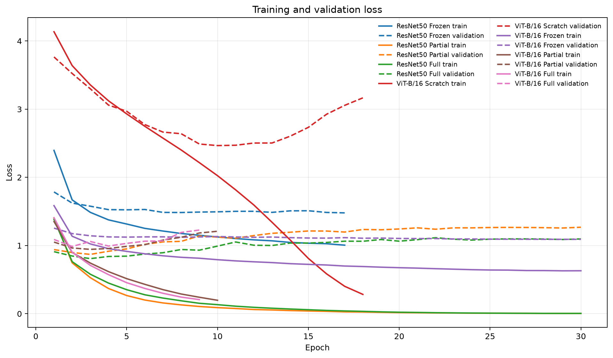
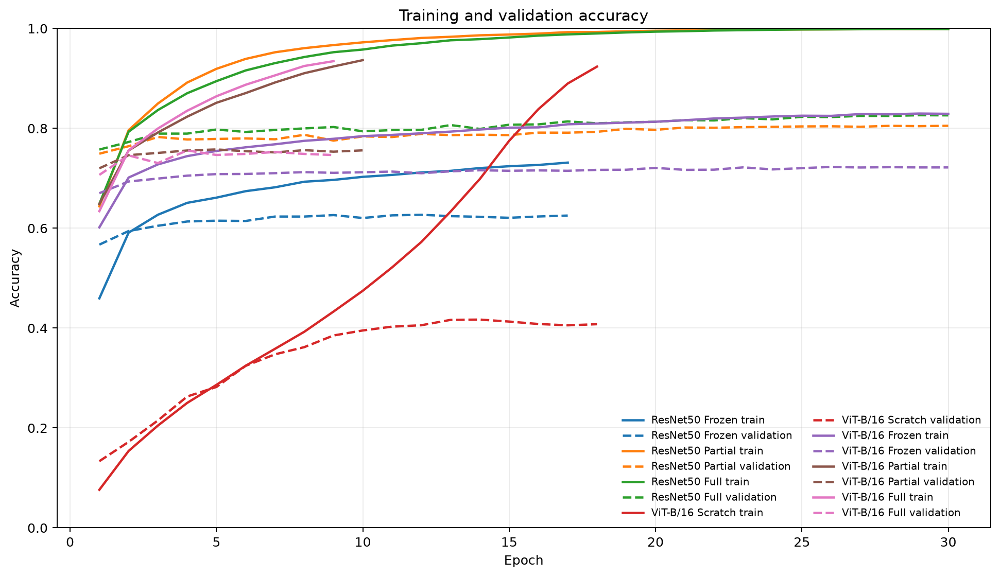
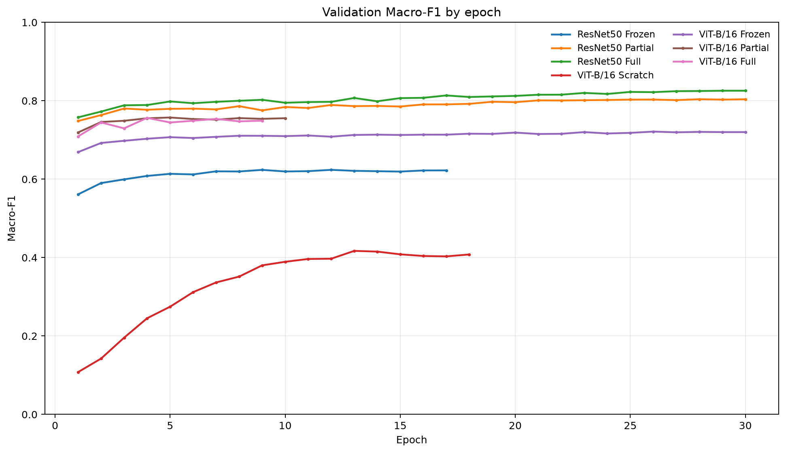
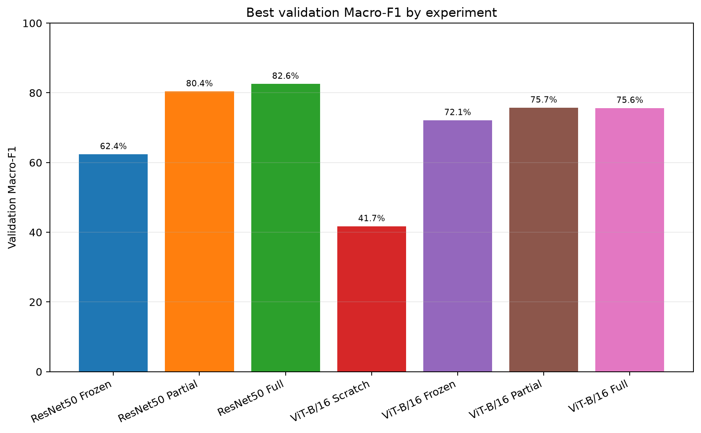
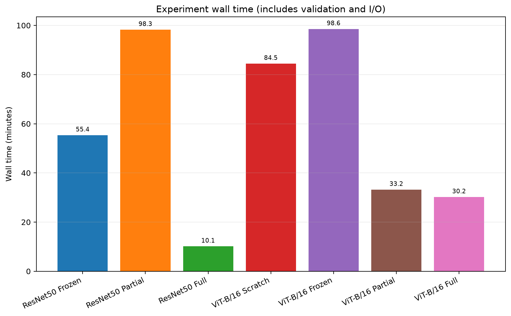
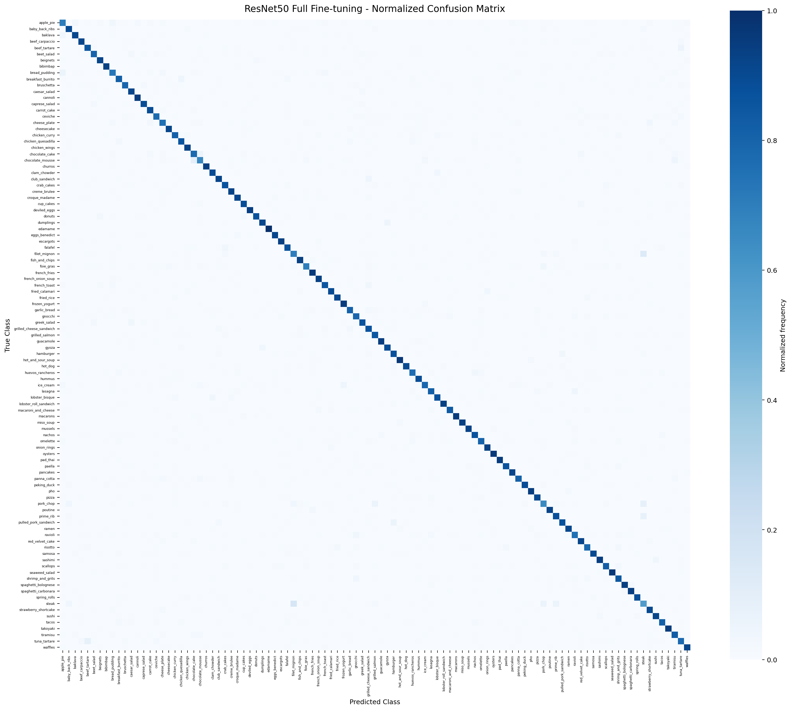
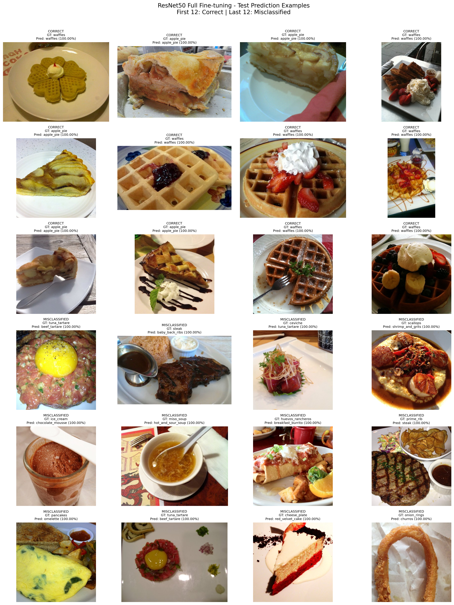
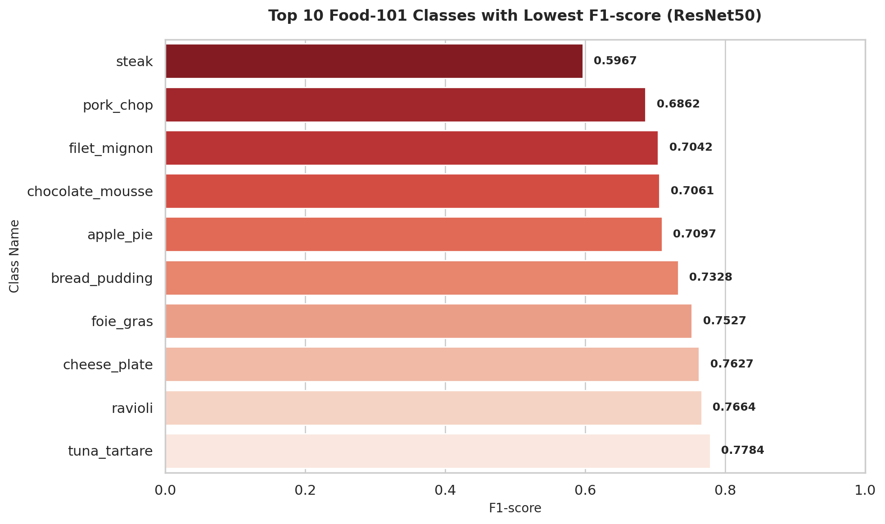
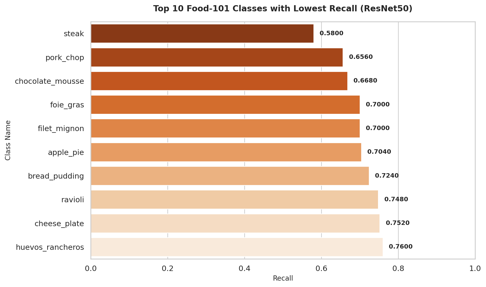
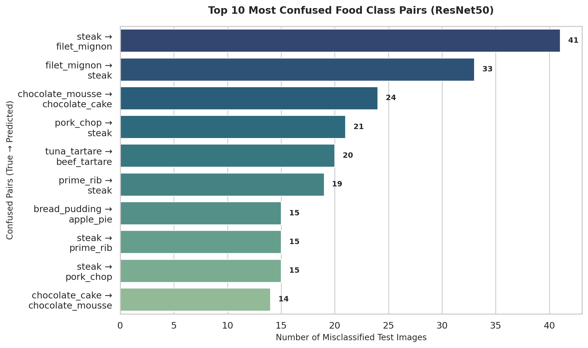

# A1-2 – Deep Learning for Food Image Classification

**Học phần:** CO5085 – Deep Learning and Its Applications in Computer Vision  
**Mốc bài tập:** A1-2 – So sánh cuối  
**Mô hình được chọn:** ResNet50 Full Fine-tuning  

> **Quy ước số liệu:** Các tỷ lệ phần trăm được làm tròn đến hai chữ số thập phân, trừ khi ghi khác. Kết quả Validation và Test được trình bày riêng. Các nhận xét về nguyên nhân lỗi là giả thuyết, không phải kết luận nhân quả.

## 1. Giới thiệu (Introduction)

Food Image Classification là bài toán nhận diện loại món ăn từ ảnh. Trong Food-101, mô hình phải phân biệt 101 lớp có thể tương đồng về màu sắc, hình dạng, nguyên liệu hoặc cách trình bày. Đây là bối cảnh phù hợp để khảo sát cả kiến trúc tích chập (CNN) lẫn kiến trúc dựa trên attention (Vision Transformer), cũng như ảnh hưởng quan sát được của khởi tạo pretrained và mức độ fine-tuning.

Mục tiêu A1-2 là hoàn thiện pipeline phân loại ảnh trên Food-101, so sánh bảy cấu hình ResNet50 và ViT-B/16 theo Accuracy và Macro-F1 trên Validation, ghi nhận thời gian và số tham số trainable, sau đó đánh giá một checkpoint duy nhất trên Test. Việc chọn checkpoint dựa trên Validation Macro-F1; Test không được dùng để chọn hay điều chỉnh mô hình.

Phạm vi triển khai gồm ba cấu hình pretrained của ResNet50, một cấu hình ViT-B/16 khởi tạo ngẫu nhiên và ba cấu hình pretrained của ViT-B/16. Vì vậy, thí nghiệm from-scratch được thực hiện trên ViT-B/16, không có cấu hình ResNet50 from-scratch trong bảy kết quả được báo cáo. Kết luận bên dưới chỉ áp dụng cho các cấu hình, split và thiết lập đã chạy.

## 2. Dataset và tiền xử lý (Dataset and Preprocessing)

### 2.1. Food-101 và phân chia dữ liệu

Food-101 gồm 101 lớp và 101.000 ảnh. Mỗi lớp có 750 ảnh thuộc metadata train chính thức và 250 ảnh thuộc metadata test chính thức [1, 2]. Protocol của dự án chia riêng 750 ảnh train chính thức theo tỷ lệ 90/10, phân tầng theo lớp: 675 ảnh train và 75 ảnh validation cho mỗi lớp. Các ảnh test chính thức được giữ nguyên.

**Bảng 1. Quy mô các tập dữ liệu Food-101. Đơn vị: ảnh.**  
**Nguồn:** `food101_split_seed42.csv`, metadata Food-101 trong workspace; manifest được kiểm tra độc lập bằng `validate_manifest.py`.

| Tập dữ liệu | Ảnh mỗi lớp | Số lớp | Tổng số ảnh | Vai trò |
|---|---:|---:|---:|---|
| Train | 675 | 101 | 68.175 | Cập nhật tham số mô hình |
| Validation | 75 | 101 | 7.575 | Theo dõi tổng quát hóa, early stopping và chọn checkpoint |
| Test | 250 | 101 | 25.250 | Đánh giá cuối cùng sau khi chốt mô hình |
| **Tổng** | **1.000** | **101** | **101.000** | — |

Manifest chứa các trường `image_path`, `class_name`, `label` và `split`. Đường dẫn ảnh tương đối theo gốc dataset; thứ tự nhãn được ánh xạ từ `classes.txt`. Manifest dùng seed 42, giữ nguyên membership của official test và không trùng ảnh giữa các split. Kiểm tra hiện có xác nhận số lớp, số lượng theo lớp/tập, nhãn, đường dẫn và membership khớp với `train.json`/`test.json`. SHA-256 trong artifacts là `57eaf01981d2f7fe291a128042fc0a31f215254e98e8c4e252726bf66c2958d9`.

### 2.2. Tiền xử lý và augmentation

Ảnh được chuyển sang RGB. Pipeline train resize cạnh ngắn đến 256 pixel, lấy `RandomCrop(224)`, lật ngang ngẫu nhiên với xác suất 0,5, chuyển thành tensor rồi chuẩn hóa theo mean/std ImageNet. Pipeline đánh giá dùng cùng resize và chuẩn hóa, nhưng thay crop ngẫu nhiên/lật ngang bằng `CenterCrop(224)`; do đó Validation/Test không dùng augmentation ngẫu nhiên.

DataLoader dùng batch size 32, shuffle train, giữ thứ tự Validation/Test, `num_workers=2`, `pin_memory=true` và không bỏ batch cuối. Trong notebook A1-2, train/validation được nạp từ manifest hiện có; các dòng Test bị bỏ qua và không khởi tạo Test DataLoader trong quá trình huấn luyện. Việc này tách giai đoạn huấn luyện/chọn mô hình khỏi đánh giá cuối.

**License và phạm vi sử dụng:** Trang Food-101 chính thức của ETH Zurich cung cấp dataset và trích dẫn bài báo, nhưng không nêu một license mở cụ thể cho ảnh [1, 2]. Bài báo mô tả ảnh được thu thập từ Foodspotting [1]; vì vậy báo cáo không xem ảnh là dữ liệu có license mở và không suy diễn quyền sử dụng vượt quá thông tin nguồn. 

**Lý do chọn Food-101:**
* Food-101 có 101 lớp và 101.000 ảnh.
* Có đủ dữ liệu để thực hiện bài toán multi-class image classification.
* Có thể sử dụng để khảo sát CNN và Vision Transformer.
* Có official train/test split, thuận tiện xây dựng protocol thực nghiệm.

### 2.3. EDA – Exploratory Data Analysis
* Kiểm tra đủ 101 classes và 101.000 ảnh.
* Kiểm tra cấu trúc thư mục và tính toàn vẹn dataset.
* Kiểm tra manifest và số lượng mẫu trong từng split.
* Kiểm tra khả năng đọc ảnh thông qua DataLoader.

## 3. Phương pháp (Methodology)

### 3.1. Kiến trúc và Transfer Learning

**ResNet50** là CNN có residual connections, cho phép xây dựng mạng sâu và truyền tín hiệu tối ưu qua các khối residual [3]. Trong triển khai, tầng phân loại cuối được thay bằng `Linear` có 101 đầu ra. Với cấu hình pretrained, backbone dùng trọng số ImageNet mặc định từ torchvision.

**ViT-B/16** chia ảnh thành các patch 16 × 16, mã hóa chuỗi patch bằng Transformer encoder và dùng classification head để dự đoán lớp [4]. Head được thay bằng tầng tuyến tính 101 lớp. Cấu hình pretrained dùng trọng số ImageNet mặc định của torchvision.

Transfer Learning ở đây là khởi tạo backbone từ trọng số pretrained rồi huấn luyện head và, tùy cấu hình, mở một phần hoặc toàn bộ backbone để thích nghi với Food-101. Cấu hình from-scratch khởi tạo toàn bộ ViT-B/16 ngẫu nhiên; pretrained được tắt.

### 3.2. Các chế độ huấn luyện đã triển khai

- **From-scratch:** mọi tham số ViT-B/16 được train từ khởi tạo ngẫu nhiên.
- **Frozen Backbone:** backbone pretrained bị đóng băng, chỉ classifier được train.
- **Partial Fine-tuning:** với ResNet50, mở `layer4` và `fc`; với ViT-B/16, mở Transformer encoder block cuối và classification heads.
- **Full Fine-tuning:** mở toàn bộ tham số của mô hình pretrained.

Không có thí nghiệm ResNet50 from-scratch trong kết quả hiện tại. Vì vậy không suy rộng kết quả ViT-B/16 from-scratch thành so sánh scratch giữa cả hai họ kiến trúc.

## 4. Thiết lập thực nghiệm (Experimental Setup)

Notebook yêu cầu chạy trên Google Colab với CUDA. Runtime được ghi trong artifacts là Python 3.13.16, PyTorch 2.14.1+cu130, torchvision 0.29.1+cu130 và CUDA 13.0. Các lần chạy không dùng cùng một GPU: ResNet50 Frozen/Partial ghi nhận NVIDIA L4; năm cấu hình còn lại ghi nhận NVIDIA A100-SXM4-80GB. Seed đặt là 42, nhưng cấu hình reproducibility không bật deterministic mode.

**Bảng 2. Hyperparameters và protocol huấn luyện.**  
**Nguồn:** `config.yaml`, các `effective_config.yaml`, notebook `A1_2_experiment.ipynb` và mã nguồn A1-2.

| Tham số | Giá trị triển khai |
|---|---|
| Kích thước đầu vào | 224 × 224 |
| Batch size | 32 |
| Số epoch tối đa | 30 |
| Early stopping | Patience 5; `min_delta=0.0` |
| Optimizer | AdamW; weight decay 0,01 |
| Learning rate – pretrained | Backbone 0,0001; head 0,001 |
| Learning rate – ViT-B/16 from-scratch | 0,0001 |
| Scheduler | CosineAnnealingLR; `T_max=30`, `eta_min=0` |
| Loss | CrossEntropyLoss |
| Model selection | Validation Macro-F1 cao nhất; hòa thì chọn Validation Accuracy cao hơn |
| Mixed precision | Bật trong các cấu hình pretrained; tắt trong ViT-B/16 from-scratch |

Early stopping và selection dùng Validation Macro-F1; Validation Accuracy chỉ là tiêu chí phân xử khi Macro-F1 bằng nhau. Các cấu hình được khởi tạo lại seed 42. Do GPU thay đổi giữa các run và deterministic mode tắt, thời gian chạy chỉ là quan sát ở runtime ghi nhận, không phải benchmark phần cứng có kiểm soát. Riêng ResNet50 Full Fine-tuning có thời gian wall-clock 607,392 giây, tương đương 10,12 phút và được làm tròn thành 10,1 phút trong Bảng 3; artifacts ghi nhận run này dùng NVIDIA A100-SXM4-80GB, trong khi ResNet50 Frozen/Partial dùng NVIDIA L4.

## 5. Kết quả huấn luyện và so sánh mô hình (Training Results and Model Comparison)

### 5.1. Lịch sử train/validation

Các biểu đồ dưới đây được tạo từ `training_log.jsonl` hiện có; các đường liền là train, đường đứt là validation.

**Hình 1. Training và validation loss theo epoch.**  

Loss train giảm mạnh ở các cấu hình ResNet50 fine-tuning, trong khi validation loss duy trì cao hơn. Đây là khoảng cách quan sát được giữa hai tập ở các epoch tốt nhất, không tự nó chứng minh nguyên nhân. ViT-B/16 from-scratch có validation loss cao hơn các cấu hình ViT pretrained trong các kết quả được ghi.

**Hình 2. Training và validation accuracy theo epoch.**  

Train accuracy của ResNet50 Partial và Full đạt xấp xỉ 99,9% tại epoch chọn được, trong khi Validation Accuracy lần lượt là 80,50% và 82,63%. Khoảng cách này là dấu hiệu cần thận trọng khi diễn giải khả năng tổng quát hóa và phù hợp để xem xét regularization hoặc augmentation bổ sung trong nghiên cứu tiếp theo.

**Hình 3. Validation Macro-F1 theo epoch.**  

Đường cong thể hiện quá trình chọn checkpoint trên Validation, không phải kết quả Test. Các run dừng ở số epoch khác nhau do early stopping; chỉ số dùng cho bảng so sánh là chỉ số của checkpoint Validation tốt nhất.

### 5.2. So sánh bảy cấu hình

**Bảng 3. So sánh kết quả tốt nhất trên Validation và chi phí chạy.**  
**Đơn vị:** Accuracy/Macro-F1 (%); thời gian wall-clock (phút); số tham số trainable (triệu).  
**Nguồn:** `summary.json`, `validation_selection.json`, `training_log.jsonl` và `effective_config.yaml` của từng thí nghiệm.

| Cấu hình | Khởi tạo | Epoch tốt nhất / đã chạy | Val Accuracy | Val Macro-F1 | Tham số trainable (M) | Thời gian (phút) | GPU |
|---|---|---:|---:|---:|---:|---:|---|
| ResNet50 Frozen | Pretrained | 12 / 17 | 62,69 | 62,38 | 0,207 | 55,4 | NVIDIA L4 |
| ResNet50 Partial | Pretrained | 28 / 30 | 80,50 | 80,39 | 15,172 | 98,3 | NVIDIA L4 |
| **ResNet50 Full Fine-tuning** | **Pretrained** | **29 / 30** | **82,63** | **82,56** | **23,715** | **10,1** | **NVIDIA A100-SXM4-80GB** |
| ViT-B/16 From-scratch | Ngẫu nhiên | 13 / 18 | 41,65 | 41,71 | 85,876 | 84,5 | NVIDIA A100-SXM4-80GB |
| ViT-B/16 Frozen | Pretrained | 26 / 30 | 72,28 | 72,13 | 0,078 | 98,6 | NVIDIA A100-SXM4-80GB |
| ViT-B/16 Partial | Pretrained | 5 / 10 | 75,78 | 75,73 | 7,166 | 33,2 | NVIDIA A100-SXM4-80GB |
| ViT-B/16 Full Fine-tuning | Pretrained | 4 / 9 | 75,58 | 75,64 | 85,876 | 30,2 | NVIDIA A100-SXM4-80GB |

ResNet50 Full Fine-tuning có Validation Macro-F1 cao nhất trong bảy cấu hình: 82,56%, cao hơn cấu hình kế tiếp là ResNet50 Partial 2,17 điểm phần trăm. Cấu hình này cũng có Validation Accuracy cao nhất (82,63%). Đây là căn cứ chọn mô hình, không phải tuyên bố rằng mô hình tốt nhất trên mọi tiêu chí hoặc mọi thiết lập.

So sánh hai họ kiến trúc trong tập cấu hình pretrained hiện có, các run ResNet50 Partial/Full đạt Macro-F1 Validation cao hơn các run ViT-B/16 Partial/Full. ViT-B/16 from-scratch đạt Macro-F1 thấp hơn đáng kể so với các cấu hình ViT pretrained. Tuy nhiên, đây là so sánh thực nghiệm trong một lần chạy cho mỗi cấu hình, với phần cứng thay đổi giữa các run; không đủ để kết luận phổ quát về CNN và Transformer.

**Hình 4. Validation Accuracy tốt nhất theo cấu hình.**  

Biểu đồ cho thấy cùng thứ hạng tổng quát của bảng: ResNet50 Full đứng đầu theo Validation Accuracy, tiếp theo là ResNet50 Partial. Biểu đồ chỉ tổng hợp các checkpoint được chọn trên Validation.

**Hình 5. Validation Macro-F1 tốt nhất theo cấu hình.**  

Macro-F1 là tiêu chí chọn mô hình và đồ thị đặt ResNet50 Full ở vị trí cao nhất. Chênh lệch với ResNet50 Partial phù hợp với giá trị trong Bảng 3.

**Hình 6. Thời gian wall-clock theo cấu hình.**  

Thời gian ghi nhận bao gồm train, validation và ghi artifacts. Vì các run sử dụng L4 hoặc A100 khác nhau, các giá trị này không phải phép so sánh hiệu năng phần cứng hoặc chi phí huấn luyện thuần. Ví dụ ResNet50 Full chạy trên A100 trong khi ResNet50 Partial chạy trên L4; không nên quy chênh lệch thời gian cho riêng kiến trúc/chế độ fine-tuning.

### 5.3. Loss và Accuracy tại epoch Validation tốt nhất

**Bảng 4. Chỉ số train và validation tại epoch được chọn cho từng run.**  
**Đơn vị:** loss (CrossEntropyLoss); Accuracy (%).  
**Nguồn:** `training_log.jsonl`, dòng tương ứng với `best_epoch` trong `summary.json`.

| Cấu hình | Epoch | Train loss | Train Accuracy | Validation loss | Validation Accuracy |
|---|---:|---:|---:|---:|---:|
| ResNet50 Frozen | 12 | 1,0834 | 71,17 | 1,5022 | 62,69 |
| ResNet50 Partial | 28 | 0,0051 | 99,89 | 1,2620 | 80,50 |
| ResNet50 Full Fine-tuning | 29 | 0,0044 | 99,90 | 1,0883 | 82,63 |
| ViT-B/16 From-scratch | 13 | 1,3415 | 63,35 | 2,5040 | 41,65 |
| ViT-B/16 Frozen | 26 | 0,6397 | 82,50 | 1,0926 | 72,28 |
| ViT-B/16 Partial | 5 | 0,5143 | 85,12 | 0,9881 | 75,78 |
| ViT-B/16 Full Fine-tuning | 4 | 0,5735 | 83,52 | 0,9924 | 75,58 |

Ở các run ResNet50 fine-tuning, train loss thấp và train accuracy cao hơn rõ rệt so với Validation. Đây là chênh lệch train/validation được đo tại checkpoint chọn; nguyên nhân và mức độ ảnh hưởng của từng yếu tố chưa được cô lập trong các thí nghiệm này.

## 6. Đánh giá trên tập Test (Final Test Evaluation)

Sau khi chọn ResNet50 Full Fine-tuning theo Validation Macro-F1, checkpoint được đánh giá trên 25.250 ảnh Test. Không dùng Test để chọn cấu hình, điều chỉnh hyperparameter hay dừng huấn luyện.

**Bảng 5. Kết quả Test của ResNet50 Full Fine-tuning.**  
**Đơn vị:** phần trăm (%) và số ảnh.  
**Nguồn:** `additional_metrics.json`, `test_metrics.json`, `classification_report.csv`, `prediction_results.csv` và `confusion_matrix.csv`.

| Chỉ số | Kết quả |
|---|---:|
| Accuracy / Top-1 Accuracy | 87,16% |
| Macro Precision | 87,12% |
| Macro Recall | 87,16% |
| Macro-F1 | 87,11% |
| Test loss | 0,7216 |
| Dự đoán đúng | 22.009 / 25.250 |
| Dự đoán sai | 3.241 / 25.250 |

Số dự đoán đúng/sai trong `prediction_results.csv` là 22.009/3.241; tổng số phần tử trong confusion matrix là 25.250 và tổng đường chéo là 22.009. Đối chiếu 25.250 đường dẫn theo thứ tự cho thấy chúng khớp với Test trong manifest và các `true_label` số cũng khớp. Tuy nhiên, có 500 trường `true_class` không khớp tên lớp trong manifest: các ảnh `cheesecake` mang nhãn số 16 nhưng được ghi tên `cheese_plate`. Vì vậy, tính nhất quán của Accuracy và tổng số dự đoán được xác nhận, nhưng không thể xem tên lớp trong prediction export là đã alignment hoàn toàn; các phân tích/bảng/ảnh dùng tên lớp từ artifacts cần được đọc với lưu ý này. Mỗi lớp trong manifest có support 250, do đó phân phối Test cân bằng theo protocol.

**Hình 7. Confusion matrix chuẩn hóa theo lớp thật trên tập Test.**  

Đường chéo đậm cho thấy phần lớn mẫu được dự đoán đúng; các ô ngoài đường chéo tập trung ở một số cặp lớp tương đồng. Đây là confusion matrix chuẩn hóa theo lớp thật; số đếm chính xác được lưu trong CSV và các cặp nhầm lẫn nổi bật được liệt kê ở Mục 7.

**Hình 8. Ví dụ dự đoán đúng và dự đoán sai trên Test.**  

Hình minh họa 12 dự đoán đúng và 12 dự đoán sai được chọn cho việc quan sát định tính. Các ví dụ giúp kiểm tra nhãn thật và nhãn dự đoán trực quan, nhưng không đại diện cho tần suất toàn bộ tập Test; kết luận định lượng vẫn dựa trên các metrics và bảng phân tích lỗi.

**Lưu ý nhất quán số liệu:** `test_metrics.json` ghi Macro-F1 là 0,871078616, trong khi `additional_metrics.json` và dòng macro average của `classification_report.csv` ghi 0,871077305. Cả hai đều làm tròn thành 87,11%; độ lệch chỉ xuất hiện ở các chữ số thập phân nhỏ hơn mức báo cáo. Báo cáo dùng giá trị làm tròn hai chữ số và ghi nhận khác biệt artifact này để xác nhận nếu cần công bố độ chính xác cao hơn.

## 7. Phân tích lỗi theo lớp (Per-class Error Analysis)

Phân tích dưới đây dựa trên artifacts của checkpoint đã chọn. Các lớp trong Test có cùng support 250 ảnh; vì vậy các mức recall có cùng mẫu số theo lớp. Precision vẫn phụ thuộc số dự đoán vào từng lớp. **Lưu ý alignment:** artifacts hiện có ghi sai tên lớp `true_class` cho 500 ảnh cheesecake (nhãn số 16 trong manifest), ghi chúng là `cheese_plate`. Do đó tên lớp liên quan trong báo cáo per-class, confusion matrix, cặp nhầm lẫn và ví dụ dự đoán chưa được xác minh độc lập; số liệu aggregate vẫn nhất quán, nhưng cần sửa/kiểm chứng mapping tên lớp trước khi diễn giải hoặc trích dẫn các kết quả theo lớp.

### 7.1. Mười lớp có F1 thấp nhất

**Bảng 6. Top 10 lớp có F1 thấp nhất trên Test.**  
**Đơn vị:** Precision, Recall, F1-score (0–1); support (ảnh).  
**Nguồn:** `per_class_error_analysis.csv` và `classification_report.csv`.

| Xếp hạng | Lớp | Precision | Recall | F1-score | Support |
|---:|---|---:|---:|---:|---:|
| 1 | steak | 0,6144 | 0,5800 | 0,5967 | 250 |
| 2 | pork_chop | 0,7193 | 0,6560 | 0,6862 | 250 |
| 3 | filet_mignon | 0,7085 | 0,7000 | 0,7042 | 250 |
| 4 | chocolate_mousse | 0,7489 | 0,6680 | 0,7061 | 250 |
| 5 | apple_pie | 0,7154 | 0,7040 | 0,7097 | 250 |
| 6 | bread_pudding | 0,7418 | 0,7240 | 0,7328 | 250 |
| 7 | foie_gras | 0,8140 | 0,7000 | 0,7527 | 250 |
| 8 | cheese_plate | 0,7737 | 0,7520 | 0,7627 | 250 |
| 9 | ravioli | 0,7857 | 0,7480 | 0,7664 | 250 |
| 10 | tuna_tartare | 0,7769 | 0,7800 | 0,7784 | 250 |

Steak có F1 thấp nhất (0,5967), tiếp theo là pork_chop (0,6862) và filet_mignon (0,7042). Cả ba lớp đều có recall dưới 0,70. Đây là quan sát về kết quả phân loại; sự tương đồng về hình ảnh món thịt là một giả thuyết có thể kiểm tra thêm, không được chứng minh riêng bởi các số liệu này.

**Hình 9. Mười lớp có F1 thấp nhất.**  

Biểu đồ cho thấy khoảng cách giữa steak và các lớp tiếp theo, đồng thời xác nhận thứ tự lớp trong Bảng 6. Đây là F1 theo lớp từ Test, không phải Validation Macro-F1 dùng để chọn mô hình.

### 7.2. Mười lớp có Recall thấp nhất

**Bảng 7. Top 10 lớp có Recall thấp nhất trên Test.**  
**Đơn vị:** Recall (0–1); số dự đoán đúng (ảnh trên 250 ảnh/lớp).  
**Nguồn:** `per_class_error_analysis.csv` và `classification_report.csv`.

| Xếp hạng | Lớp | Recall | Dự đoán đúng / support |
|---:|---|---:|---:|
| 1 | steak | 0,5800 | 145 / 250 |
| 2 | pork_chop | 0,6560 | 164 / 250 |
| 3 | chocolate_mousse | 0,6680 | 167 / 250 |
| 4 | foie_gras | 0,7000 | 175 / 250 |
| 5 | filet_mignon | 0,7000 | 175 / 250 |
| 6 | apple_pie | 0,7040 | 176 / 250 |
| 7 | bread_pudding | 0,7240 | 181 / 250 |
| 8 | ravioli | 0,7480 | 187 / 250 |
| 9 | cheese_plate | 0,7520 | 188 / 250 |
| 10 | huevos_rancheros | 0,7600 | 190 / 250 |

Steak có recall 0,58, tương ứng 105 ảnh trong lớp này bị gán sang lớp khác. Thứ hạng gần với bảng F1 nhưng không đồng nhất: `huevos_rancheros` nằm trong nhóm recall thấp nhất, trong khi `tuna_tartare` thuộc nhóm F1 thấp nhất nhưng recall 0,78. Điều này minh họa rằng F1 và Recall đo các khía cạnh khác nhau.

**Hình 10. Mười lớp có Recall thấp nhất.**  

Biểu đồ cho thấy mức recall thấp nhất của steak/pork_chop và các lớp còn lại trong top 10. Các giá trị là tỷ lệ trên từng lớp, không phải số lượng lỗi tuyệt đối toàn tập.

### 7.3. Mười cặp nhầm lẫn thường gặp nhất

**Bảng 8. Top 10 cặp nhầm lẫn có hướng trên Test.**  
**Đơn vị:** số ảnh; chiều `lớp thật → lớp dự đoán`.  
**Nguồn:** `top10_confused_class_pairs.csv`.

| Xếp hạng | Lớp thật → lớp dự đoán | Số ảnh |
|---:|---|---:|
| 1 | steak → filet_mignon | 41 |
| 2 | filet_mignon → steak | 33 |
| 3 | chocolate_mousse → chocolate_cake | 24 |
| 4 | pork_chop → steak | 21 |
| 5 | tuna_tartare → beef_tartare | 20 |
| 6 | prime_rib → steak | 19 |
| 7 | bread_pudding → apple_pie | 15 |
| 8 | steak → prime_rib | 15 |
| 9 | steak → pork_chop | 15 |
| 10 | chocolate_cake → chocolate_mousse | 14 |

Hai hướng nhầm lẫn giữa steak và filet_mignon xuất hiện 41 và 33 lần; chúng là các hướng riêng biệt, không gộp thành một giá trị đối xứng. Các cặp chocolate_mousse/chocolate_cake cũng xuất hiện theo cả hai hướng. Tương đồng về kết cấu, màu sắc, góc chụp hoặc cách trình bày có thể là giả thuyết giải thích; để kiểm chứng cần phân tích ảnh có kiểm soát, metadata bổ sung hoặc thí nghiệm riêng.

**Hình 11. Mười cặp lớp thường bị nhầm lẫn nhất.**  

Biểu đồ dùng số đếm theo hướng và xác nhận cặp steak → filet_mignon đứng đầu với 41 ảnh. Số đếm ở đây là lỗi theo từng hướng, không phải tổng lỗi của cả hai lớp.

## 8. Thảo luận (Discussion)

### 8.1. Hiệu quả của ResNet50 Full Fine-tuning

Trong bảy cấu hình thực nghiệm, ResNet50 Full Fine-tuning đạt Validation Macro-F1 cao nhất (82,56%) và được chọn theo đúng tiêu chí đã định. Kết quả Test của checkpoint này là Accuracy 87,16% và Macro-F1 87,11%. Tại epoch tốt nhất, Train Accuracy là 99,90% so với Validation Accuracy 82,63%, chênh 17,27 điểm phần trăm. ResNet50 Partial có Train Accuracy 99,89% và Validation Accuracy 80,50%, chênh 19,38 điểm phần trăm. Đây là các khoảng cách Train/Validation lớn, phù hợp với dấu hiệu cần lưu ý về khả năng tổng quát hóa/overfitting; các kết quả này chưa xác định nguyên nhân hay chứng minh tác động của một yếu tố cụ thể.

### 8.2. CNN và Vision Transformer trong thiết lập này

Các cấu hình ResNet50 Partial/Full có Validation Macro-F1 cao hơn các cấu hình ViT-B/16 Partial/Full trong lần chạy hiện có. ViT-B/16 from-scratch thấp hơn các cấu hình pretrained của chính ViT-B/16. Đây là kết quả trong Food-101 split và hyperparameters đã ghi, không phải bằng chứng rằng CNN luôn vượt Transformer hoặc ViT không phù hợp với dữ liệu ảnh.

Các run không hoàn toàn đồng nhất về phần cứng: hai cấu hình ResNet50 dùng L4 còn các cấu hình khác dùng A100. Vì vậy, so sánh Accuracy/Macro-F1 trên cùng split vẫn mô tả được kết quả của từng checkpoint, nhưng thời gian chạy không thể dùng như so sánh công bằng về tốc độ. Ngoài ra, không có ResNet50 from-scratch nên không thể đối chiếu trực tiếp scratch-vs-pretrained giữa cả hai họ.

### 8.3. Ưu điểm, hạn chế và yếu tố ảnh hưởng

Ưu điểm của protocol là split theo manifest có thể kiểm chứng, Test được giữ ngoài huấn luyện/chọn mô hình, cả hai họ kiến trúc pretrained đều có ba chế độ fine-tuning và artifacts lưu metrics theo epoch. Việc đánh giá macro theo 101 lớp và phân tích lỗi từng lớp bổ sung góc nhìn ngoài Accuracy tổng thể.

Hạn chế gồm một lần chạy cho mỗi cấu hình, không bật deterministic mode, mức GPU không đồng nhất, chưa có ResNet50 from-scratch, chưa khảo sát seed/hyperparameter lặp lại và chưa có phân tích định lượng về memory. Khoảng cách train/validation ở ResNet50 fine-tuning cũng cần được xem xét khi triển khai tiếp. Các yếu tố như độ đa dạng ảnh, crop, góc chụp, nền, độ phân giải và mức tương đồng giữa lớp có thể ảnh hưởng đến lỗi, nhưng chưa được cô lập thành thí nghiệm trong A1-2.

### 8.4. Những hướng chưa khảo sát

Các hướng tiếp theo gồm lặp lại nhiều seed, chuẩn hóa phần cứng hoặc đo riêng thời gian train, thêm ResNet50 from-scratch, khảo sát learning rate/regularization/augmentation, và đo peak GPU memory. Có thể phân tích riêng các cặp nhầm lẫn phổ biến và đánh giá độ tin cậy dự đoán, nhưng cần thiết kế thí nghiệm mới thay vì suy luận nhân quả từ các artifacts hiện tại.

## 9. Kết luận (Conclusion)

A1-2 đã triển khai và so sánh bảy cấu hình ResNet50/ViT-B/16 trên Food-101 với các chế độ from-scratch, frozen backbone, partial fine-tuning và full fine-tuning có trong phạm vi thí nghiệm. ResNet50 Full Fine-tuning được chọn theo Validation Macro-F1 đạt 82,56%; trên Test, mô hình đạt 87,16% Accuracy và 87,11% Macro-F1, với 22.009 dự đoán đúng trên 25.250 ảnh.

Phân tích Test ghi nhận lớp steak có F1 và Recall thấp nhất, và cặp steak → filet_mignon là nhầm lẫn có hướng phổ biến nhất. Các kết quả này cung cấp mục tiêu cụ thể cho phân tích dữ liệu/augmentation tiếp theo. Kết luận chỉ giới hạn ở những run đã thực hiện; khác biệt GPU, thiếu lặp seed và một số thông tin A1.1 còn thiếu cần được giải quyết trước khi mở rộng diễn giải.

## Tài liệu tham khảo

1. Lukas Bossard, Matthieu Guillaumin, and Luc Van Gool. “Food-101 – Mining Discriminative Components with Random Forests.” European Conference on Computer Vision (ECCV), 2014. [Trang dataset chính thức của ETH Zurich](https://data.vision.ee.ethz.ch/cvl/datasets_extra/food-101/) · [Bài báo PDF do ETH Zurich lưu trữ](https://data.vision.ee.ethz.ch/cvl/datasets_extra/food-101/static/bossard_eccv14_food-101.pdf).
2. Computer Vision Lab, ETH Zurich. “The Food-101 Data Set.” [Trang dataset chính thức](https://data.vision.ee.ethz.ch/cvl/datasets_extra/food-101/). Trang này cung cấp mô tả và cách trích dẫn dataset; không nêu license mở cụ thể cho các ảnh.
3. Kaiming He, Xiangyu Zhang, Shaoqing Ren, and Jian Sun. “Deep Residual Learning for Image Recognition.” Proceedings of the IEEE Conference on Computer Vision and Pattern Recognition (CVPR), 2016, pp. 770–778. [CVF Open Access](https://openaccess.thecvf.com/content_cvpr_2016/html/He_Deep_Residual_Learning_CVPR_2016_paper.html).
4. Alexey Dosovitskiy et al. “An Image Is Worth 16x16 Words: Transformers for Image Recognition at Scale.” International Conference on Learning Representations (ICLR), 2021. [OpenReview](https://openreview.net/forum?id=YicbFdNTTy).
