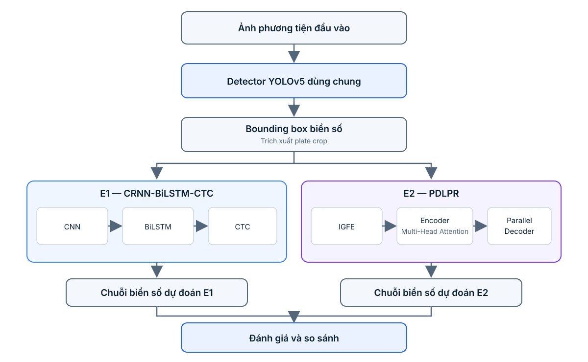

# A2.1 — Chốt chủ đề, Paper, Dataset và kế hoạch thực nghiệm

**Môn học:** CO5085 – Deep Learning and Its Applications in Computer Vision  
**Assignment:** A2 – Self-chosen Topic + Paper Analysis  
**Chủ đề:** Automatic License Plate Recognition for Vietnamese Vehicles from Still Images  
**Phiên bản:** A2.1 – Updated proposal for supervisor review  
**Học viên:** Trần Thái Học – 2570426

---

## 1. Giới thiệu đề tài

### 1.1. Tên đề tài

**Automatic License Plate Recognition (ALPR) for Vietnamese Vehicles from Still Images**

### 1.2. Phát biểu bài toán

Automatic License Plate Recognition (ALPR) là bài toán tự động phát hiện vị trí biển số và nhận dạng chuỗi ký tự trên biển số từ ảnh phương tiện.

Đề tài tập trung xây dựng và đánh giá một pipeline ALPR cho phương tiện tại Việt Nam, sử dụng ảnh tĩnh làm đầu vào. Hệ thống gồm hai nhiệm vụ:

1. **License Plate Detection:** Phát hiện vị trí biển số trong ảnh và trích xuất vùng ảnh biển số.
2. **License Plate Recognition:** Nhận dạng chuỗi ký tự từ vùng biển số đã được trích xuất.

Bài toán tập trung vào biển số Việt Nam có bố cục một dòng hoặc hai dòng, kích thước khác nhau và điều kiện ảnh không đồng nhất.

### 1.3. Mục tiêu

- Xây dựng pipeline phát hiện và nhận dạng biển số Việt Nam từ ảnh tĩnh.
- Triển khai một pipeline chạy được từ ảnh đầu vào đến chuỗi ký tự đầu ra.
- So sánh ít nhất hai phương pháp nhận dạng trên cùng một detector: CRNN-CTC và PDLPR.
- Đánh giá riêng detection, recognition và hiệu quả end-to-end.
- Phân tích ảnh hưởng của bố cục một dòng/hai dòng và chất lượng ảnh đến kết quả.

### 1.4. Phạm vi

**Trong phạm vi:**

- Ảnh tĩnh; không xử lý video hoặc tracking.
- Biển số xe Việt Nam.
- Biển số một dòng và hai dòng có trong dataset.
- Detection và recognition.

**Ngoài phạm vi:**

- Nhận dạng hoặc phân loại loại phương tiện.
- Theo dõi phương tiện qua nhiều khung hình.
- Xây dựng hệ thống production hoặc tối ưu triển khai thời gian thực trên thiết bị biên.
- Đề xuất một kiến trúc ALPR hoàn toàn mới.

---

## 2. Paper được lựa chọn

### 2.1. Thông tin paper

**Title:** *A Real-Time License Plate Detection and Recognition Model in Unconstrained Scenarios*  
**Authors:** Lingbing Tao, Shunhe Hong, Yongxing Lin, Yangbing Chen, Pingan He, and Zhixin Tie.  
**Journal:** *Sensors*, 2024, Volume 24, Issue 9, Article 2791.  
**Publisher:** MDPI.  
**DOI:** https://doi.org/10.3390/s24092791  
**Official paper:** https://www.mdpi.com/1424-8220/24/9/2791  
**PubMed record:** https://pubmed.ncbi.nlm.nih.gov/38732896/  

### 2.2. Lý do lựa chọn

- Paper giải quyết trực tiếp bài toán license plate detection and recognition.
- Phương pháp được mô tả thành hai phần rõ ràng: YOLOv5 cho detection và PDLPR cho recognition.
- PDLPR có các thành phần kiến trúc cụ thể để phân tích: Improved Global Feature Extractor (IGFE), encoder sử dụng Multi-Head Attention và Parallel Decoder.
- Paper có thực nghiệm so sánh và ablation study để đánh giá các thành phần của phương pháp.
- Paper được xuất bản trong *Sensors* (MDPI), có quy trình peer review; thông tin bài báo và DOI được ghi nhận trên PubMed. Việc kiểm tra trạng thái chỉ mục SCIE/Scopus cần được đối chiếu theo năm và danh mục chính thức tại thời điểm nộp báo cáo.

### 2.3. Tóm tắt phương pháp

Paper đề xuất **YOLOv5-PDLPR**, gồm hai giai đoạn:

1. **Detection – YOLOv5:** phát hiện và định vị vùng biển số trong ảnh phương tiện.
2. **Recognition – PDLPR:** nhận dạng chuỗi ký tự từ ảnh biển số đã crop, không yêu cầu tách từng ký tự bằng một detector riêng.

PDLPR gồm ba ý tưởng/thành phần chính:

- **Improved Global Feature Extractor (IGFE):** trích xuất đặc trưng hình ảnh biển số.
- **Encoder with Multi-Head Attention:** mã hóa đặc trưng và khai thác quan hệ giữa các vị trí đặc trưng.
- **Parallel Decoder:** dự đoán chuỗi ký tự theo cấu trúc giải mã song song nhằm cải thiện hiệu quả inference.

Paper báo cáo kết quả trên các benchmark biển số được sử dụng trong nghiên cứu, trong đó có CCPD. Tác giả báo cáo average accuracy 99.4% và tốc độ nhận dạng 159.8 FPS trong thiết lập thực nghiệm của paper. Đây là kết quả của tác giả trên dữ liệu và điều kiện đánh giá của họ, không phải kết quả dự kiến hoặc cam kết cho VNLP.

### 2.4. Novelty và điểm cần đánh giá

Đóng góp của paper nằm ở cách thiết kế và kết hợp IGFE, Multi-Head Attention và Parallel Decoder cho recognition biển số. Các thành phần nền tảng như residual block và attention đã có trong nghiên cứu trước; vì vậy không nên mô tả chúng riêng lẻ là kỹ thuật hoàn toàn mới.

Điểm phù hợp để phân tích trong A2:

- Vai trò của từng module trong recognition.
- Sự khác biệt giữa giải mã tuần tự của CRNN/BiLSTM và Parallel Decoder.
- Kết quả ablation mà tác giả dùng để kiểm chứng IGFE và decoder.
- Khả năng chuyển giao phương pháp từ dữ liệu biển số trong paper sang biển số Việt Nam.

### 2.5. Hạn chế và cách áp dụng vào đề tài

- Dữ liệu chính trong paper không phải dữ liệu biển số Việt Nam; bộ ký tự và phân bố bố cục khác VNLP.
- Không thể sử dụng trực tiếp kết quả accuracy/FPS trong paper để đại diện cho hiệu quả trên VNLP.
- Chưa xác minh được official implementation và pretrained weights do chính tác giả paper phát hành. Do đó, kế hoạch cần dự phòng việc tự triển khai PDLPR theo mô tả trong paper.
- PDLPR cần được điều chỉnh output/character vocabulary theo nhãn thực tế của VNLP, đồng thời kiểm tra cách biểu diễn chuỗi cho biển một dòng và hai dòng.

**Vai trò của paper trong A2:** Paper được chọn làm phương pháp nghiên cứu chính để phân tích và tái triển khai ở mức phù hợp với assignment. Nhóm không tuyên bố tái tạo nguyên bản toàn bộ kết quả paper; mục tiêu là triển khai pipeline trên VNLP và so sánh PDLPR với một baseline recognition có cơ sở.

---

## 3. Dataset

### 3.1. Dataset được lựa chọn

**Tên:** Vietnamese License Plate (VNLP) Dataset  
**Official repository:** https://github.com/fict-labs/VNLP

**Bộ dataset này không có thông tin license chính thức. Đã gửi mail và chờ đồng ý của tác giả**

Repository mô tả VNLP là bộ dữ liệu biển số Việt Nam gồm khoảng 37.300 ảnh, có bounding box và nhãn chuỗi ký tự. Dataset được chia thành hai nhóm theo bố cục biển số.

### 3.2. Thống kê theo repository

| Thuộc tính | Thông tin được repository công bố |
|---|---:|
| Tổng số ảnh | Khoảng 37.300 |
| Biển số một dòng | 19.086 |
| Biển số hai dòng | 18.211 |
| Số ký tự mỗi biển | 6–9 |
| Nhãn vị trí | Bounding box |
| Nhãn nhận dạng | Chuỗi ký tự |

Các con số trên là thống kê do repository công bố. Số lượng mẫu thực tế sử dụng sẽ được xác nhận sau khi tải dữ liệu, kiểm tra file và loại bỏ mẫu lỗi/trùng lặp nếu có.

### 3.3. Lý do lựa chọn

- Dữ liệu phù hợp trực tiếp với biển số Việt Nam.
- Có bounding box để huấn luyện detector.
- Có chuỗi ký tự để huấn luyện recognizer.
- Có cả bố cục một dòng và hai dòng.
- Quy mô dữ liệu phù hợp với một bài assignment có giới hạn thời gian và tài nguyên.

Repository VNLP cũng dẫn các công trình liên quan đến việc xây dựng và sử dụng dataset. Khi sử dụng dữ liệu, báo cáo sẽ trích dẫn các công trình được repository yêu cầu, bên cạnh đường dẫn repository.

### 3.4. Chia dữ liệu

Dự kiến chia dữ liệu theo tỷ lệ:

| Split | Tỷ lệ | Mục đích |
|---|---:|---|
| Training | 70% | Huấn luyện |
| Validation | 15% | Theo dõi huấn luyện và chọn checkpoint |
| Testing | 15% | Đánh giá cuối cùng |

Protocol:

- Cố định random seed.
- Duy trì tỷ lệ tương đối giữa biển một dòng và hai dòng ở các split.
- Kiểm tra ảnh trùng lặp hoặc gần trùng lặp để hạn chế data leakage.
- Chia dữ liệu trước khi tạo crop cho recognition.
- Không dùng test set để chọn hyperparameters hoặc checkpoint.

Đây là split do đề tài thiết kế, không khẳng định là split chuẩn có sẵn của tác giả dataset. Số lượng mẫu mỗi split sẽ được báo cáo sau bước audit dữ liệu.

### 3.5. Tiền xử lý dự kiến

**Detection:**

- Đọc ảnh và bounding box.
- Chuyển annotation sang định dạng YOLO nếu cần.
- Resize theo input size của YOLOv5.
- Áp dụng augmentation có kiểm soát như brightness/contrast, blur, noise và geometric transformation; phải biến đổi bounding box đồng bộ với ảnh.

**Recognition:**

- Tạo plate crop từ ground-truth bounding box cho training/validation recognition.
- Resize và normalize theo yêu cầu từng recognizer.
- Xây dựng character vocabulary từ nhãn VNLP.
- Kiểm tra quy ước thứ tự ký tự của biển hai dòng để chuỗi ground truth nhất quán.
- Trong đánh giá end-to-end, sử dụng crop từ detection prediction thay vì ground-truth crop.

---

## 4. Phương pháp và thiết kế so sánh

### 4.1. Thiết kế tổng thể

Để so sánh recognition một cách công bằng, sử dụng **cùng một YOLOv5 detector** cho cả hai pipeline. Chỉ thay đổi recognition model:

- **E1 – Baseline:** YOLOv5 + CRNN-BiLSTM-CTC.
- **E2 – Paper-inspired method:** YOLOv5 + PDLPR.

Như vậy, khác biệt chính giữa E1 và E2 nằm ở recognizer, không phải detector.

### 4.2. Pipeline E1 — CRNN-BiLSTM-CTC

CRNN là baseline nhận dạng chuỗi ảnh phổ biến:

- CNN: trích xuất đặc trưng từ ảnh biển số.
- BiLSTM: học quan hệ tuần tự hai chiều trên chuỗi đặc trưng.
- CTC: huấn luyện chuỗi mà không cần căn chỉnh nhãn từng ký tự với từng vị trí ảnh.

### 4.3. Pipeline E2 — PDLPR

Tái triển khai PDLPR theo mô tả trong paper:

- IGFE: trích xuất đặc trưng toàn cục.
- Encoder với Multi-Head Attention: mã hóa quan hệ giữa các vị trí đặc trưng.
- Parallel Decoder: dự đoán chuỗi ký tự bằng cấu trúc giải mã song song.

Cần điều chỉnh kích thước input, character vocabulary và output sequence phù hợp với VNLP. Các chi tiết triển khai chưa được paper/code chính thức xác nhận sẽ được ghi rõ là quyết định triển khai của đề tài, không gán thành cấu hình nguyên bản của tác giả.

### 4.4. Sơ đồ pipeline

*Hình 1. Cùng một detector YOLOv5 cung cấp vùng biển số cho hai phương pháp nhận dạng; kết quả được đưa vào đánh giá và so sánh.*

### 4.5. Quy tắc đảm bảo so sánh công bằng

- Cùng dataset và train/validation/test split.
- Cùng YOLOv5 detector và cùng detector checkpoint cho cả E1, E2.
- Khi đánh giá recognition riêng, dùng cùng ground-truth plate crops.
- Khi đánh giá end-to-end, dùng cùng detection predictions/crops.
- Dùng cùng character vocabulary, quy tắc chuẩn hóa chuỗi và tiêu chí exact match.
- Công bố cấu hình training, input size, epoch, optimizer, learning rate, batch size và checkpoint được chọn cho từng recognizer.
- Báo cáo rõ mô hình nào dùng pretrained weights và nguồn checkpoint. Không xem pretrained YOLOv5 là pretrained PDLPR.

---

## 5. Evaluation Metrics

### 5.1. Detection

| Metric | Ý nghĩa |
|---|---|
| Precision | Tỷ lệ detection dự đoán đúng trên tổng detection được dự đoán |
| Recall | Tỷ lệ biển số ground truth được phát hiện |
| mAP@0.5 | Mean Average Precision tại IoU 0.5 |
| mAP@0.5:0.95 | mAP trung bình trên nhiều ngưỡng IoU |

Detector được huấn luyện/đánh giá độc lập một lần; cùng kết quả detector được dùng cho cả hai recognizer trong so sánh chính.

### 5.2. Recognition

| Metric | Ý nghĩa |
|---|---|
| Character Accuracy | Tỷ lệ ký tự dự đoán đúng theo quy tắc căn chỉnh được định nghĩa |
| Exact Plate Accuracy | Tỷ lệ chuỗi biển số khớp hoàn toàn với ground truth |
| CER | Character Error Rate ở cấp độ ký tự |

\[
CER = \frac{S + D + I}{N}
\]

Trong đó S là số ký tự thay thế, D là số ký tự bị xóa, I là số ký tự chèn thêm và N là tổng số ký tự ground truth.

### 5.3. End-to-End

**End-to-End Exact Plate Recognition Rate:** tỷ lệ ảnh đầu vào mà hệ thống phát hiện đúng biển số theo ngưỡng IoU được xác định trước và nhận dạng chính xác toàn bộ chuỗi ký tự.

Cần báo cáo rõ ngưỡng IoU và cách xử lý ảnh không phát hiện được biển số. Ảnh không phát hiện được biển số được tính là thất bại ở metric end-to-end.

### 5.4. Computational metrics

Nếu tài nguyên cho phép, báo cáo thêm:

- FPS hoặc latency (ms/image), ghi rõ đo trên CPU/GPU và batch size.
- Number of Parameters.
- Model Size.

Không so sánh FPS nếu khác biệt môi trường đo hoặc cách tính không được mô tả.

---

## 6. Kế hoạch thực nghiệm và ablation

### 6.1. Thí nghiệm chính

| Experiment | Detection | Recognition | Mục đích |
|---|---|---|---|
| E1 | YOLOv5 cố định | CRNN-BiLSTM-CTC | Baseline recognition |
| E2 | YOLOv5 cố định | PDLPR | Đánh giá phương pháp trong paper trên VNLP |

Báo cáo kết quả theo ba mức: detection, recognition trên ground-truth crops và end-to-end trên detection crops.

### 6.2. Ablation dự kiến

Nếu thời gian và tài nguyên cho phép, thực hiện ít nhất một ablation trên PDLPR:

- **A1:** PDLPR đầy đủ so với biến thể bỏ Multi-Head Attention; hoặc
- **A2:** PDLPR đầy đủ so với biến thể thay Parallel Decoder bằng decoder tuần tự phù hợp.

Chỉ đưa ra kết luận về đóng góp của module khi các cấu hình còn lại được giữ cố định. Nếu không đủ thời gian triển khai ablation, báo cáo sẽ tập trung vào so sánh E1/E2 và phân tích kiến trúc/ablation đã công bố trong paper, đồng thời nêu rõ giới hạn này.

### 6.3. Phân tích theo nhóm dữ liệu

Ngoài kết quả tổng thể, phân tích Exact Plate Accuracy và CER theo:

- Biển số một dòng.
- Biển số hai dòng.
- Nhóm ảnh chất lượng tốt và nhóm ảnh khó (nếu có thể định nghĩa tiêu chí phân nhóm nhất quán).

Điều này giúp xác định mô hình nào phù hợp hơn với bố cục đặc thù của biển số Việt Nam.

---

## 7. Tính khả thi và rủi ro

### 7.1. Tính khả thi

- VNLP có quy mô khoảng 37.300 ảnh và có cả bounding box lẫn chuỗi ký tự theo repository.
- YOLOv5 có implementation công khai và có thể fine-tune bằng pretrained detector weights.
- CRNN-CTC là baseline tương đối phù hợp để tự triển khai.
- PDLPR có mô tả kiến trúc và ablation trong paper, nhưng cần tự triển khai nếu không tìm được implementation chính thức.
- Có thể chia quá trình huấn luyện thành detector và recognizer, giúp kiểm soát tài nguyên GPU.

### 7.2. Rủi ro và phương án dự phòng

| Rủi ro | Phương án xử lý |
|---|---|
| Không có official PDLPR code/weights đã xác minh | Tự triển khai theo paper; giới hạn phạm vi module nếu cần và ghi rõ sai khác |
| PDLPR khó tái hiện trong thời gian A2 | Ưu tiên hoàn thiện E1; triển khai PDLPR tối thiểu để có so sánh hai phương pháp |
| Biển hai dòng gây lỗi thứ tự ký tự | Audit nhãn, chuẩn hóa thứ tự đọc và đánh giá riêng hai nhóm bố cục |
| Dataset có ảnh lỗi/trùng lặp | Kiểm tra dữ liệu trước khi split và ghi lại số mẫu bị loại |
| Thiếu tài nguyên GPU | Dùng YOLOv5 model nhỏ, giảm batch/input size và huấn luyện recognition riêng |
| Kết quả recognition tốt trên crop nhưng giảm mạnh end-to-end | Báo cáo riêng recognition và end-to-end để phân tích ảnh hưởng của detection |

---

## 8. Kế hoạch thực hiện

| Giai đoạn | Công việc |
|---|---|
| Phase 1 | Audit VNLP, annotation, character vocabulary và ảnh trùng lặp |
| Phase 2 | Tạo train/validation/test split cố định; chuẩn bị YOLO labels và plate crops |
| Phase 3 | Fine-tune và đánh giá YOLOv5 detector |
| Phase 4 | Huấn luyện CRNN-BiLSTM-CTC baseline |
| Phase 5 | Triển khai và huấn luyện PDLPR trên VNLP |
| Phase 6 | Chạy recognition evaluation, end-to-end evaluation và ablation khả thi |
| Phase 7 | Tổng hợp bảng kết quả, phân tích lỗi và viết báo cáo |

A2.1 xác định chủ đề, paper, dataset và protocol. A2.2 trình bày triển khai, thực nghiệm, so sánh và phân tích kết quả thực tế.

---

## 9. Kết luận và đề xuất chốt đề tài

Đề tài đề xuất xây dựng hệ thống **Automatic License Plate Recognition for Vietnamese Vehicles from Still Images** trên dataset VNLP.

Paper nghiên cứu chính là Tao et al. (2024), *A Real-Time License Plate Detection and Recognition Model in Unconstrained Scenarios*, đề xuất YOLOv5-PDLPR. Đề tài sẽ dùng YOLOv5 làm detector chung và so sánh hai recognition model: CRNN-BiLSTM-CTC (baseline) và PDLPR (paper-inspired method). Thiết kế này tạo ra hai pipeline có thể chạy và so sánh trên cùng dữ liệu, cùng detector và cùng protocol.

Phạm vi được giới hạn ở ảnh tĩnh, detection và recognition biển số Việt Nam một dòng/hai dòng. Kết quả sẽ được đánh giá bằng detection metrics, recognition metrics và end-to-end metrics. Mục tiêu không phải tuyên bố tạo ra kiến trúc mới, mà là tái triển khai có kiểm soát một phương pháp trong paper và đánh giá khả năng áp dụng của nó trên dữ liệu biển số Việt Nam.

**Đề xuất xin ý kiến giáo sư:** chốt đề tài ALPR trên VNLP; sử dụng YOLOv5-PDLPR làm paper nghiên cứu chính; triển khai hai biến thể YOLOv5 + CRNN-CTC và YOLOv5 + PDLPR để đáp ứng yêu cầu pipeline và so sánh của A2.

---

## 10. References

1. Tao, L., Hong, S., Lin, Y., Chen, Y., He, P., & Tie, Z. (2024). *A Real-Time License Plate Detection and Recognition Model in Unconstrained Scenarios*. Sensors, 24(9), 2791. https://doi.org/10.3390/s24092791
2. VNLP Dataset. *Vietnamese License Plate Dataset*. Official GitHub repository. https://github.com/fict-labs/VNLP
3. Trinh, T.-A.-L., Pham, T.-A., & Hoang, V.-D. (2022). *Layout-invariant license plate detection and recognition*. International Conference on Multimedia Analysis and Pattern Recognition (MAPR 2022). (Citation information as listed by the VNLP repository.)
4. Pham, T.-A. (2023). *Effective deep neural networks for license plate detection and recognition*. The Visual Computer, 39(3), 927–941. (Citation information as listed by the VNLP repository.)
5. Shi, B., Bai, X., & Yao, C. (2017). *An End-to-End Trainable Neural Network for Image-Based Sequence Recognition and Its Application to Scene Text Recognition*. IEEE Transactions on Pattern Analysis and Machine Intelligence. https://doi.org/10.1109/TPAMI.2016.2646371
6. Ultralytics. *YOLOv5 Documentation and source code*. https://github.com/ultralytics/yolov5

---

## Ghi chú xác minh trước khi nộp

- Xác nhận số lượng file thực tế và khả năng tải VNLP; repository hiện mô tả khoảng 37.300 ảnh, 19.086 ảnh một dòng và 18.211 ảnh hai dòng.
- Kiểm tra lại trạng thái SCIE/Scopus của *Sensors* bằng nguồn danh mục chính thức tương ứng với năm xuất bản nếu cần ghi cụ thể trong phần venue analysis.
- Chưa xác minh được official code và pretrained weights do tác giả YOLOv5-PDLPR phát hành. Không dẫn repository bên thứ ba như official implementation.
- Các thông số huấn luyện, split, kết quả trên VNLP và ablation của đề tài chỉ được ghi nhận sau khi thực nghiệm; không sử dụng số liệu của paper làm kết quả của mình.
