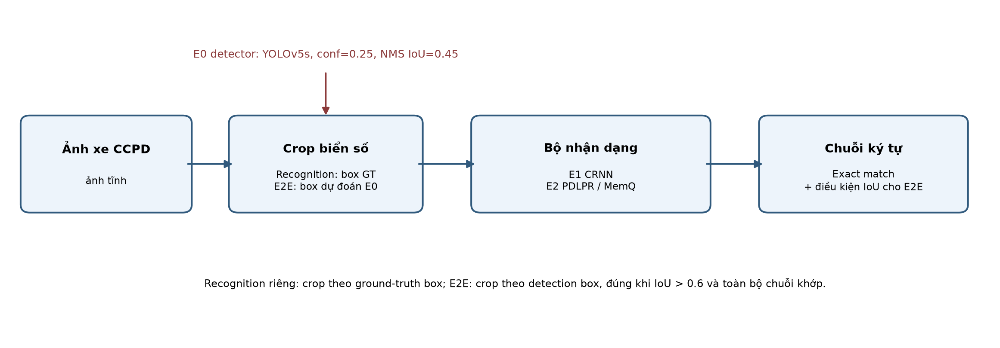
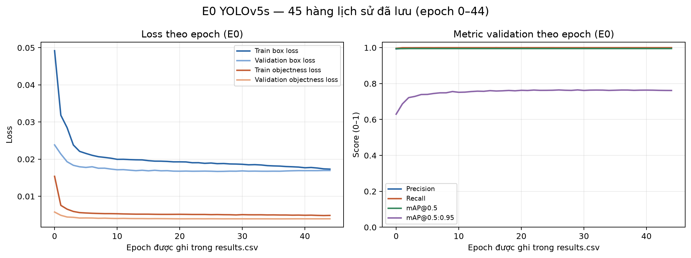
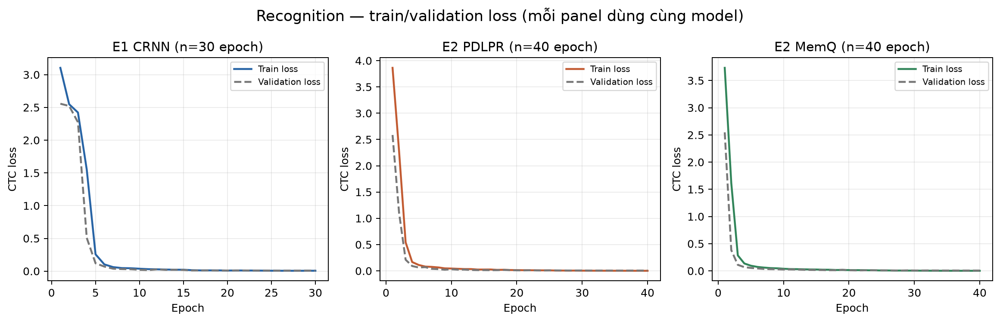
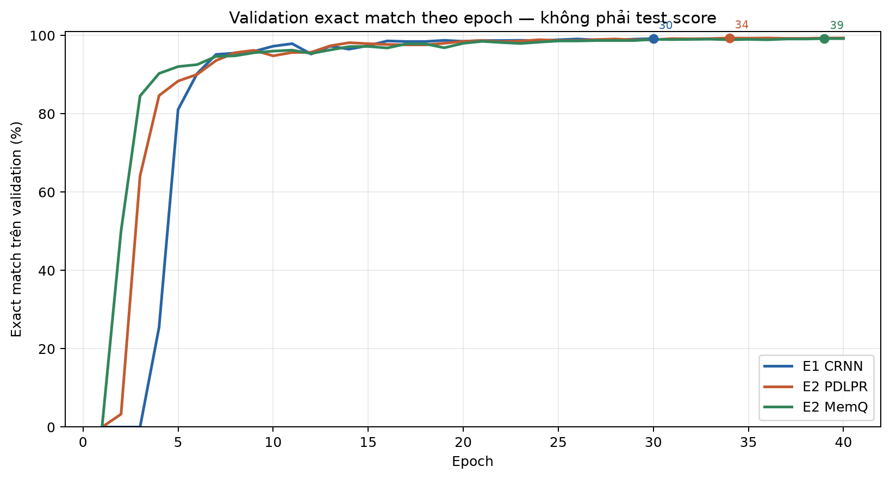
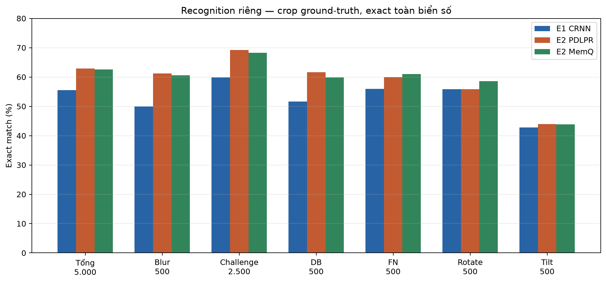
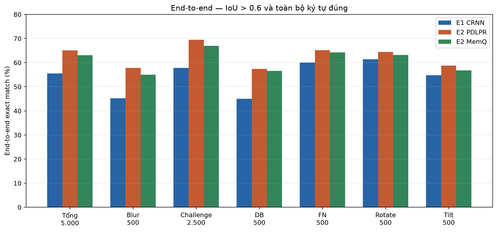
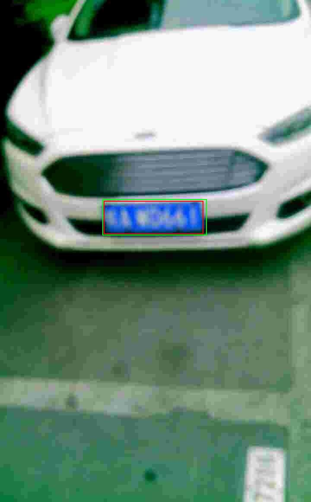

# Báo cáo A2 — Phát hiện và nhận dạng biển số trên CCPD

**Môn học:** CO5085 — Deep Learning and Its Applications in Computer Vision  
**Phạm vi:** detector E0 YOLOv5s, so sánh nhận dạng E1 CRNN và E2 PDLPR-inspired cùng biến thể `e2_pdlpr_memq`  
**Nguồn kết quả:** các notebook, JSON, CSV và history đã lưu trong repository. Không chạy lại huấn luyện hoặc suy luận.

> **Phạm vi bằng chứng.** Repository hiện không có PDF/rubric A2 chính thức hoặc dataset/manifest gốc. Yêu cầu được đối chiếu từ brief do người dùng cung cấp, mô tả trong [A2-2](../../A2-2/index.html), kế hoạch [A2.1](../../A2-1/topic_paper_dataset.md) và hai notebook. Số liệu dataset, metric và cấu hình dưới đây là số liệu đã lưu; nơi không thể xác minh độc lập được ghi rõ.

## 1. Tóm tắt và mục tiêu

Báo cáo xây dựng pipeline ALPR cho ảnh tĩnh: YOLOv5s phát hiện một vùng biển số (E0), sau đó CRNN hoặc PDLPR-inspired nhận dạng chuỗi ký tự (E1/E2). Mục tiêu là so sánh ít nhất hai phương pháp nhận dạng trên cùng bộ ảnh và phân tích một nghiên cứu liên quan, không tuyên bố tái hiện nguyên bản paper.

Trên 5.000 crop ground-truth, E1 CRNN đạt exact match **55,54%**, E2 PDLPR đạt **62,88%**, và `e2_pdlpr_memq` đạt **62,54%**. Đây là recognition riêng. End-to-end dùng crop từ detector và điều kiện IoU riêng; E2 đạt **65,08%** theo protocol IoU > 0,6. Hai metric khác protocol, không cần bằng nhau.

Các kết quả chính phản ánh một lần chạy cho mỗi cấu hình, không có thống kê nhiều seed. E2 history có 40 epoch (best epoch 34 và 39). Đối chiếu manifest E0 chưa hoàn tất: các tập đường dẫn không khớp và file gốc không có trong repository.

## 2. Bài toán và dữ liệu

ALPR gồm hai bước: (1) phát hiện box biển số trong ảnh xe; (2) nhận dạng toàn bộ chuỗi ký tự bên trong box. Phạm vi thực nghiệm là ảnh tĩnh và dữ liệu CCPD được đóng gói thành `yolo_detection.zip`; không đánh giá video, tracking, biển nhiều dòng hoặc biển ngoài miền dữ liệu này.

Artifact E0 ghi nhận 25.000 mẫu đã kiểm tra:

| Split | Số ảnh | Vai trò / phân bố đã lưu |
|---|---:|---|
| Train | 18.000 | Huấn luyện; ví dụ đường dẫn manifest thuộc `ccpd_base` |
| Validation | 2.000 | Chọn checkpoint và theo dõi quá trình học |
| Test | 5.000 | Đánh giá cuối; Blur 500, Challenge 2.500, DB 500, FN 500, Rotate 500, Tilt 500 |

Các số đếm và kiểm tra file là kết quả được lưu trong [e0_report.json](../results/detection/e0_report.json) và output notebook. Báo cáo đó ghi nhận ảnh đọc được, nhãn YOLO hợp lệ, không thiếu/nhãn mồ côi trong từng split. Tuy nhiên, trường `all_valid` chỉ áp dụng cho tính toàn vẹn ảnh/nhãn. So sánh path manifest không khớp ở train 18.000/18.000, val 2.000/2.000 và test 5.000/5.000. Ví dụ manifest `ccpd_base/<stem>` so với ảnh `<stem>`; test có `ccpd_blur/<stem>` so với `ccpd_blur__<stem>`. Vì dataset và manifest gốc không có ở đây, chưa thể kết luận đây chỉ là khác cách biểu diễn hay là file khác/thiếu; không áp dụng alias path để ép khớp.

Các CSV nhận dạng xác nhận test gồm 5.000 mẫu với phân bố subset như bảng trên. Dataset gốc, file split chính thức, kiểm tra ảnh trùng và mapping manifest không thể kiểm tra độc lập từ các file được commit.

## 3. Tiền xử lý, crop, DataLoader và augmentation

- **Detection:** ảnh có nhãn YOLO một lớp `license_plate`; ảnh đầu vào detector 640 px. Theo `augmentation_config.json`, YOLO dùng HSV (0,015/0,7/0,4), translate 0,1, scale 0,5, horizontal flip 0,5 và mosaic 1,0; mixup, vertical flip, shear, perspective và copy-paste bằng 0.
- **Recognition crop:** notebook cắt biển số từ box trong nhãn YOLO, cộng margin 10%, và lưu `crop_rel`, text, subset, split cùng tọa độ box trong metadata. E2E thay box ground-truth bằng box detector. Không có cây ảnh crop riêng trong repository để xem lại từng crop.
- **Kích thước/chuẩn hóa:** ảnh crop resize thành 48×144; tensor được normalize với mean/std 0,5 cho mỗi kênh.
- **Augmentation nhận dạng:** `ColorJitter` xác suất 0,8; `RandomAffine` (rotation ±5°, translation, scale 0,9–1,1, shear) xác suất 0,7; Gaussian blur xác suất 0,3. Validation/test không dùng augmentation ngẫu nhiên.
- **DataLoader:** batch 128, train shuffle, evaluation không shuffle, `drop_last=False`, 2 workers, seed 42. AMP bật khi chạy CUDA.
- **Nhãn và loss:** chuỗi CCPD được mã hóa thành vocabulary; CTC blank có chỉ số 0. Cả E1 và E2 dùng CTC và greedy CTC decoding.

## 4. Pipeline và cấu hình thực nghiệm

Hình 1 tóm tắt hai protocol đánh giá. Recognition riêng dùng crop ground-truth; E2E đưa ảnh gốc qua E0 rồi nhận dạng crop dự đoán.

*Hình 1. Pipeline theo notebook A2: E0 YOLOv5s, các recognizer E1/E2 và khác biệt giữa crop ground-truth với crop detector.*

Đề xuất trong [A2.1](../../A2-1/topic_paper_dataset.md) dự kiến dùng YOLO26n; notebook và kết quả E0 hiện tại dùng **YOLOv5s**. Đây là thay đổi so với đề xuất, được notebook E0 ghi là lựa chọn để dùng detector cùng họ với paper. Vì vậy, báo cáo mô tả đúng kết quả đang có, không gọi đây là thí nghiệm YOLO26n.

| Thành phần | Cấu hình có bằng chứng |
|---|---|
| E0 detector | YOLOv5s, pretrained `yolov5s.pt`, ảnh 640, batch 32, tối đa 50 epoch, patience 15, seed 42, SGD, lr0 0,01, momentum 0,937, weight decay 0,0005 |
| E1 CRNN | 30 epoch; Adam, lr 0,001, weight decay 0 |
| E2 PDLPR / MemQ | 40 epoch; AdamW, lr 0,0002, weight decay 0,01, warmup 3 epoch, cosine schedule |
| Phần cứng được ghi nhận | NVIDIA L4, CUDA cho kết quả nhận dạng và E0 |

Detector log có 45 hàng, epoch 0–44; log ghi dừng sớm sau khi không cải thiện trong 15 epoch và checkpoint tốt nhất tại epoch 29. Con số 50 là cấu hình tối đa, không phải số epoch đã chạy. Hình 2 được dựng từ `results.csv`.

*Hình 2. Trục trái: box/objectness loss train và validation. Trục phải: precision, recall, mAP@0.5 và mAP@0.5:0.95 (score 0–1). Nguồn: `A2/results/detection/runs/yolov5s_ccpd_e0/results.csv`; epoch được ghi từ 0 đến 44.*

## 5. Detector E0 và các mô hình nhận dạng

### E0 — YOLOv5s

E0 là detector một lớp `license_plate`. Ngoài checkpoint tốt nhất epoch 29, báo cáo còn lưu P/R, mAP, cấu hình augmentation và phép đánh giá theo ngưỡng IoU. Trong test log mAP của YOLOv5 dùng `conf_thres=0.001`; phép đo paper-comparable/E2E dùng confidence 0,25 và NMS IoU 0,45. Đây là các protocol khác nhau.

### E1 — CRNN-BiLSTM-CTC

CRNN dùng CNN trích đặc trưng, BiLSTM hai lớp hai chiều để xử lý chuỗi theo chiều rộng và linear head tạo logits cho CTC. Với input 48×144, notebook ghi output chuỗi dài 36 bước. Đây là baseline tuần tự; không phải cùng một mô hình RNN-attention như phần paper phê bình.

### E2 — PDLPR-inspired và MemQ

`e2_pdlpr` dùng IGFE (Focus, residual/CNN blocks và downsampling), ba encoder unit có Multi-Head Attention, sau đó ba decoder unit với self-attention/cross-attention và CTC head. Cấu hình trong code có 8 heads, 18 query và logits `[B,18,C]`. Biến thể `e2_pdlpr_memq` lấy query từ đặc trưng memory thay vì dùng query học được. Hai mô hình có khoảng 26,67 triệu tham số; CRNN khoảng 8,48 triệu.

Notebook gọi E2 là **PDLPR-inspired** và liệt kê các sai khác so với paper; vì vậy kết quả ở đây không phải reproduction nguyên bản.

## 6. Metric và kết quả detection

Recognition metrics được tính từ toàn bộ chuỗi dự đoán:

- `exact`: toàn bộ chuỗi bằng ground-truth.
- `exact_no_province`: chuỗi bằng nhau sau khi bỏ ký tự tỉnh đầu tiên.
- `province_acc`: ký tự đầu tiên bằng nhau.
- `char_acc`: `1 - tổng edit distance / tổng số ký tự ground-truth`.

E0 có hai nhóm kết quả, không nên gộp:

| Split / protocol | N | Precision | Recall | mAP@0.5 | mAP@0.5:0.95 | Metric bổ sung |
|---|---:|---:|---:|---:|---:|---|
| Validation, YOLO `val.py` | 2.000 | 0,999 | 1,000 | 0,995 | 0,764 | — |
| Test, YOLO `val.py` | 5.000 | 0,984 | 0,983 | 0,983 | 0,609 | — |
| Test, per-image paper-comparable | 5.000 | — | — | — | — | Accuracy IoU > 0,7: 0,8802; mean top-1 IoU: 0,80345; 11 ảnh không detection; 96,27 FPS |

Các metric mAP lấy từ `e0_report.json` và log validation/test tương ứng; phép đo per-image dùng box top-confidence và điều kiện IoU > 0,7. FPS của phép đo này được tính batch=1, gồm tiền xử lý, inference và NMS, không gồm đọc file; phần cứng là NVIDIA L4. Với test phân nhóm, detector lưu duy nhất nhóm `(root)`, nên artifact không hỗ trợ kết luận detector theo từng subset CCPD.

Đối chiếu manifest **chưa hoàn tất**, dù kết quả detection vẫn có metric. Không có cơ sở để diễn giải `all_valid` thành xác minh đầy đủ dataset và manifest.

## 7. So sánh recognition E1, E2 và MemQ

Bảng dùng `results/` làm kết quả chính; mọi exact-match trong bảng đều dùng crop ground-truth trên cùng 5.000 test mẫu.

| Mô hình | Epoch chạy / best epoch | Tham số | Exact | Exact bỏ ký tự tỉnh | Province acc. | Char acc. | Tốc độ batch 1 / 64 (ảnh/s) |
|---|---:|---:|---:|---:|---:|---:|---:|
| E1 CRNN | 30 / 30 | 8,48 M | 0,5554 | 0,6088 | 0,9312 | 0,8926 | 199,0 / 8.536,6 |
| E2 PDLPR-inspired | 40 / 34 | 26,67 M | **0,6288** | **0,6714** | **0,9436** | 0,9105 | 89,6 / 3.524,0 |
| E2 MemQ | 40 / 39 | 26,66 M | 0,6254 | 0,6698 | 0,9406 | **0,9115** | 95,7 / 3.663,5 |

Nguồn: `recognition/results/comparison_overall.csv`, các JSON model và `models/*/history.csv`. Exact match của E2 cao hơn E1 7,34 điểm phần trăm; MemQ cao hơn E1 7,00 điểm nhưng thấp hơn E2 chuẩn 0,34 điểm. MemQ có char accuracy cao nhất một chút, song không có exact-match cao nhất. E1 ít tham số hơn và throughput cao hơn trong benchmark nhận dạng đã lưu.

Đây không phải so sánh hoàn toàn kiểm soát được về optimizer/ngân sách: E1 dùng Adam trong 30 epoch, còn E2 dùng AdamW trong 40 epoch. Cùng input, crop policy, seed, CTC và test protocol không loại bỏ ảnh hưởng của khác biệt huấn luyện. Tốc độ nhận dạng đo trên tensor ngẫu nhiên đã cấp phát sẵn, sau warm-up, gồm forward/decode; không phải latency toàn pipeline.

Hình 3 và 4 dùng history validation, không dùng test để vẽ đường cong. Checkpoint E2 được chọn theo validation; các epoch có cùng giá trị cực đại sau checkpoint không thay thế checkpoint cũ vì code chỉ lưu khi cải thiện nghiêm ngặt.

*Hình 3. CTC loss theo epoch; mỗi panel dùng trục riêng cho một mô hình. Nguồn: `A2/results/recognition/models/{e1_crnn,e2_pdlpr,e2_pdlpr_memq}/history.csv`.*

*Hình 4. Exact match validation (%) theo epoch; nhãn tại điểm đánh dấu là best epoch: 30, 34 và 39. Không phải test accuracy.*

### Theo subset

| Subset (số mẫu) | E1 CRNN | E2 PDLPR | E2 MemQ |
|---|---:|---:|---:|
| Blur (500) | 0,5000 | 0,6120 | 0,6060 |
| Challenge (2.500) | 0,5984 | **0,6924** | 0,6832 |
| DB (500) | 0,5160 | **0,6160** | 0,5980 |
| FN (500) | 0,5600 | 0,6000 | **0,6100** |
| Rotate (500) | 0,5580 | 0,5580 | **0,5860** |
| Tilt (500) | 0,4280 | **0,4400** | 0,4380 |

*Hình 5. Recognition riêng: exact match toàn chuỗi (%) trên crop ground-truth. Nhãn trục ghi số mẫu từng nhóm. Nguồn: JSON recognition trong `A2/results/recognition/results/`.*

Challenge là nhóm có exact-match cao nhất cho cả ba mô hình; Tilt là nhóm thấp nhất. E2 chuẩn đứng đầu Blur, Challenge, DB và Tilt; MemQ đứng đầu FN và Rotate. Không có nhiều lần chạy để đánh giá độ biến thiên nên các chênh lệch nhỏ không chứng minh ưu thế có ý nghĩa thống kê.

## 8. Kết quả end-to-end

E2E chạy E0 trên ảnh gốc (confidence 0,25, NMS IoU 0,45), lấy detection có confidence cao nhất, crop box dự đoán với margin 10%, rồi chạy recognizer. **E2E exact** là tỷ lệ trên toàn bộ 5.000 ảnh thỏa đồng thời `IoU > 0.6` và exact text match. Detection rate được báo cáo riêng tại IoU > 0,7.

| Recognizer | E2E exact (mẫu số 5.000, IoU > 0,6 + exact) | Recognition exact khi IoU > 0,7 | Detection IoU > 0,7 | E2E throughput (ảnh/s) |
|---|---:|---:|---:|---:|
| E1 CRNN | 0,5554 | 0,5908 | 0,8802 | 56,61 |
| E2 PDLPR-inspired | **0,6508** | **0,6842** | 0,8802 | 41,66 |
| E2 MemQ | 0,6308 | 0,6633 | 0,8802 | 42,67 |

`recog_acc_when_det_ok` là accuracy có điều kiện trên **4.401** ảnh có IoU > 0,7; không phải mẫu số 5.000. E2E throughput được tính từ thời gian inference detector + recognizer; không gồm toàn bộ chi phí đọc ảnh/cắt crop.

Recognition riêng đo crop từ ground-truth box; E2E đo crop từ detection box. Crop, vị trí biên, kích thước và nội dung ảnh vào recognizer vì thế khác nhau. CSV hiện có 5.000 dòng theo cùng thứ tự và khớp `(subset, gt)` với CSV recognition, phù hợp với cùng test table; nhưng E2E CSV chưa lưu `crop_rel`, và các cặp `(subset, gt)` có lặp nên không thể nối duy nhất từng dòng. Notebook hiện được cập nhật để lưu ID crop và metadata checkpoint ở các output tương lai. Các JSON E2E đã lưu không ghi epoch/hash recognizer; do đó không thể xác minh độc lập checkpoint cụ thể của kết quả hiện tại.

*Hình 6. Tỷ lệ end-to-end exact match (%); mọi nhóm dùng điều kiện IoU > 0,6 và đúng toàn chuỗi. Mẫu số từng subset ghi trên trục; tổng dùng 5.000 ảnh. Nguồn: `A2/results/end_to_end/results/e2e_*.json`.*

## 9. Lỗi và hiệu năng theo subset

Các output phân tích dự đoán của notebook ghi nhận 2.223 lỗi E1, 1.856 lỗi E2 PDLPR và 1.873 lỗi MemQ trên 5.000 mẫu recognition. Các vị trí thường sai của E2 tập trung ở ký tự thứ 3 (553 lỗi), thứ 7 (525) và thứ 4 (496); MemQ có 359 lỗi độ dài chuỗi so với 137 ở E2 chuẩn. Các cặp nhầm thường gặp được output ghi nhận gồm `6/8`, `7/2`, `D/0`, `B/8` và `0/2`. Đây là thống kê từ output notebook, không phải confusion matrix đầy đủ.

E0 có 11 ảnh không detection trong 5.000 ảnh ở phép đo per-image IoU > 0,7. CSV `sample_failures.csv` chỉ chứa 5 mẫu chẩn đoán; cả 5 đều ghi `gt=1`, `pred=1`, `tp_iou50=1`, `fp=0`, `fn=0`. Vì vậy chúng không phải failure cases và không đại diện cho toàn bộ test. Có thể dùng một ảnh làm minh họa detection đúng:

*Hình 7. Ảnh nằm trong output `failure_analysis`; dòng tương ứng trong CSV ghi một ground-truth, một prediction và TP tại IoU 0,5. Đây là ảnh minh họa true positive, không phải lỗi detector.*

Không có confusion matrix nhận dạng hoặc ảnh crop của các lỗi recognition trong repository. Kết luận lỗi vì vậy giới hạn ở số đếm/nhóm ký tự lưu trong notebook và exact-match theo subset.

## 10. Phân tích paper liên quan

Paper chính là Tao et al., *A Real-Time License Plate Detection and Recognition Model in Unconstrained Scenarios*, *Sensors* 24(9), 2791 (2024), DOI [10.3390/s24092791](https://doi.org/10.3390/s24092791). Paper đề xuất pipeline **YOLOv5 + PDLPR**:

1. **Detection:** YOLOv5 nhận ảnh xe và trả về vùng biển số.
2. **Recognition:** IGFE trích đặc trưng từ crop 48×144; encoder dùng Multi-Head Attention; Parallel Decoder dự đoán chuỗi mà không cần tách ký tự bằng detector riêng.
3. **Thực nghiệm:** bài báo báo cáo kết quả trên CCPD và các ablation về Focus/IGFE, loại decoder, số attention head và số decoding unit. Tài liệu A2 ghi nhận xu hướng ablation tốt nhất ở 8 heads và 3 decoding units. Bài báo còn có thí nghiệm trên các tập AOLP-AC/LE/RP.
4. **Kết quả được tác giả báo cáo:** bài báo nêu accuracy detection theo ảnh 96,7% tại IoU > 0,7 và 218,3 FPS; phần tóm tắt nêu average recognition accuracy 99,4% và 159,8 FPS. Các số này thuộc thiết lập/hardware của tác giả; không xem là metric của dự án này.

So sánh triển khai:

| Hạng mục | Paper | Artifact A2 hiện có | Hệ quả |
|---|---|---|---|
| Detector | YOLOv5 | YOLOv5s, không phải YOLO26n như đề xuất A2.1 | Có thay đổi giữa kế hoạch và triển khai; không khẳng định pipeline YOLO26n |
| Recognition | PDLPR của paper | E2 PDLPR-inspired, cùng E1 CRNN và MemQ | Không phải reproduction nguyên bản |
| Input recognition | 48×144 | 48×144 | Kích thước khớp |
| Decoder/training | Paper mô tả CTC và Parallel Decoder; ghi chú A2 về paper nêu ngân sách 1.000 epoch | 18 query; self-attention không mask, cross-attention, CTC; 40 epoch | Ít epoch hơn nhiều; không so trực tiếp kết quả |
| Phần cứng | Bài báo ghi RTX 2080 Ti cho phép đo tốc độ | Kết quả hiện có ghi NVIDIA L4 | FPS không so sánh trực tiếp |

Notebook nêu các khác biệt kỹ thuật cụ thể của E2: paper không chỉ rõ kênh IGFE nên code dùng 64/128/512; encoder conv kernel 1 dùng padding 0 thay vì padding 1 để giữ kích thước đặc trưng; một số block decoder được thay bằng conv `(6,1)`; residual/LayerNorm, LeakyReLU 0,1, dropout 0,1 và positional encoding sin-cos 2D là quyết định triển khai. `e2_pdlpr_memq` thay query học được bằng đặc trưng memory.

Một điểm chưa nhất quán trong mô tả paper mà notebook ghi nhận: hình decoder thể hiện “output shifted right” giống teacher forcing tự hồi quy, trong khi phần văn bản mô tả huấn luyện CTC. Cài đặt A2 chọn decoder query song song cùng CTC, không tuyên bố giải quyết hay tái hiện chính xác thiết kế gốc.

Paper cũng nêu khó khăn với ký tự Hán hiếm; ghi chú A2 cho biết ký tự tỉnh “皖” chiếm tỷ trọng rất lớn trong CCPD. Kết quả A2 báo cáo riêng `province_acc` (E2 0,9436; MemQ 0,9406), nhưng không có thí nghiệm trên biển số quốc gia khác. Do khác ngân sách, checkpoint, decoder và quy trình dữ liệu, các accuracy/FPS trên không thể dùng để kết luận A2 tái hiện được hay bác bỏ kết quả paper.

**Tài liệu tham khảo**

1. Tao, L., Hong, S., Lin, Y., Chen, Y., He, P., & Tie, Z. (2024). “A Real-Time License Plate Detection and Recognition Model in Unconstrained Scenarios.” *Sensors*, 24(9), 2791. [DOI](https://doi.org/10.3390/s24092791).
2. Xu, Z. et al. (2018). “Towards End-to-End License Plate Detection and Recognition: A Large Dataset and Baseline.” ECCV 2018. [Bài báo](https://openaccess.thecvf.com/content_ECCV_2018/papers/Zhenbo_Xu_Towards_End-to-End_License_ECCV_2018_paper.pdf).
3. [CCPD dataset repository](https://github.com/detectRecog/CCPD).

## 11. Thảo luận, giới hạn và hướng cải thiện

- **Dữ liệu/manifest:** nguồn gốc file và mapping `output_path` chưa được xác minh; cần chạy lại validation trên dataset và manifest gốc trước khi tuyên bố dataset đã được đối chiếu hoàn toàn.
- **Khác biệt kế hoạch–triển khai:** A2.1 đề xuất YOLO26n, trong khi E0 hiện là YOLOv5s. Bản báo cáo này mô tả kết quả thực tế; nếu tiếp tục, cần cập nhật rationale hoặc thực hiện đúng kế hoạch.
- **So sánh recognition:** cùng crop policy, kích thước, seed, CTC và test set, nhưng khác optimizer và epoch; không thể quy toàn bộ chênh lệch cho kiến trúc. Mỗi cấu hình chỉ có một seed, không có confidence interval.
- **Protocol:** recognition riêng dùng GT crop; E2E dùng predicted crop. E2E CSV thiếu ID duy nhất và JSON thiếu checkpoint hash/epoch cho run hiện có, làm hạn chế kiểm toán từng mẫu/checkpoint.
- **Phân tích lỗi:** E0 chỉ có 5 mẫu chẩn đoán và không có failure trong mẫu đó; recognition không có crop lỗi hay confusion matrix đầy đủ. E0 test subset bị nhóm thành `(root)`.
- **Tính tổng quát:** các split CCPD và ký tự Hán không đại diện cho biển số nhiều dòng hoặc hệ ký tự ngoài dữ liệu. Không có bằng chứng về khả năng chuyển miền.
- **Lần chạy plateau:** `results_run1_plateau/` có 9 epoch `val_exact=0` và prediction rỗng; được giữ làm hồ sơ lỗi, không dùng làm kết quả đại diện. Bảng chính dùng `results/`.
- **Hướng cải thiện:** xác minh manifest/file identity; lưu sample ID và hash checkpoint trong mọi CSV/JSON; cân bằng ngân sách optimizer/epoch hoặc báo cáo nhiều seed; lưu confusion matrix/crops lỗi; phân tích detector theo subset sau khi mapping subset được xác minh.

## 12. Kết luận

Artifact hiện có cho thấy E2 PDLPR-inspired đạt exact-match recognition cao nhất trong ba mô hình (**0,6288** trên GT crops), còn MemQ đạt **0,6254** và CRNN **0,5554**. E2 cũng đạt E2E exact **0,6508** khi tính trên toàn bộ 5.000 ảnh với điều kiện IoU > 0,6 và toàn chuỗi chính xác. Các kết quả này thuộc hai protocol riêng và không được gộp.

E0 YOLOv5s có mAP@0.5 test **0,983** và accuracy per-image **0,8802** tại IoU > 0,7 theo artifact. Tuy nhiên, path manifest vẫn không khớp và không có dữ liệu gốc trong repository để xác minh nguyên nhân; đây là giới hạn quan trọng của kết luận về dataset. A2 đáp ứng phần so sánh recognition bằng E1/E2/MemQ và có phân tích paper, nhưng E2 là triển khai lấy cảm hứng từ paper, không phải reproduction nguyên bản.
