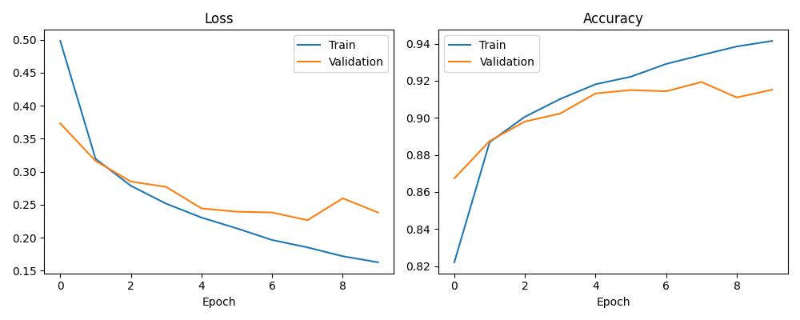
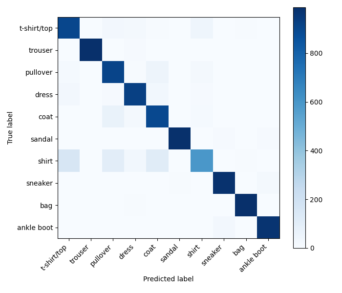
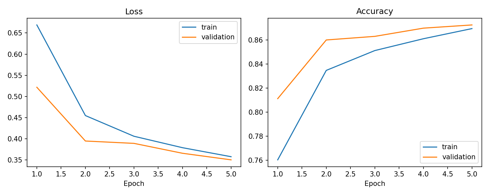

# Báo cáo thực nghiệm E1 và E2

**Môn học:** Deep Learning and Its Applications in Computer Vision — CO5085

**Sinh viên:** Trần Thái Học (MSSV 2570426; theo thông tin trong các tệp của repository)

**Ngày nộp:** 26 tháng 10 năm 2026

**Trạng thái báo cáo:** Báo cáo tổng hợp dựa trên hai notebook Colab đã thực thi (`E1/notebooks/E1_experiment.ipynb`, `E2/notebooks/e2_experiments.ipynb`) và các tư liệu kết quả được lưu trong repository

> **Tình trạng tài liệu đặc tả.** Trong quá trình kiểm tra, không tìm thấy PDF đề bài E1/E2 chính thức, `exercise-vne.pdf` hoặc rubric chấm điểm trong repository, các branch đã theo dõi hay thư mục bài tập lân cận. Vì vậy, báo cáo mô tả phần công việc đã triển khai và các yêu cầu được ghi nhận trong repository; báo cáo không khẳng định đã đối chiếu đầy đủ với tài liệu đặc tả chính thức chưa có.

## Mục lục

- [Tóm tắt](#tóm-tắt)
- [1. Giới thiệu](#1-giới-thiệu)
- [2. Yêu cầu và phương pháp thực nghiệm](#2-yêu-cầu-và-phương-pháp-thực-nghiệm)
- [3. E1: Triển khai và kết quả thực nghiệm](#3-e1-triển-khai-và-kết-quả-thực-nghiệm)
- [4. E2: Triển khai và kết quả thực nghiệm](#4-e2-triển-khai-và-kết-quả-thực-nghiệm)
- [5. Phân tích so sánh](#5-phân-tích-so-sánh)
- [6. Thảo luận và hạn chế](#6-thảo-luận-và-hạn-chế)
- [7. Kết luận và công việc tiếp theo](#7-kết-luận-và-công-việc-tiếp-theo)
- [Tài liệu tham khảo](#tài-liệu-tham-khảo)
- [Phụ lục A: Bằng chứng và khả năng tái lập](#phụ-lục-a-bằng-chứng-và-khả-năng-tái-lập)

## Tóm tắt

E1 so sánh các bộ phân loại Softmax, multilayer perceptron (MLP) và
convolutional neural network (CNN) trên Fashion-MNIST. Repository có mã
training, notebook Colab, model checkpoint, tư liệu kết quả và phân tích trực
quan. Theo lần chạy mới nhất của notebook E1 (Colab, 02/11/2026), test
accuracy lần lượt là 84.19% (Softmax), 87.92% (MLP) và 91.22% (CNN). Trong
các lần chạy này, CNN có ít parameters hơn MLP nhưng nhiều hơn Softmax. Những
quan sát này chỉ mô tả các lần chạy đã lưu, không phải bằng chứng về ý nghĩa
thống kê qua nhiều seed. Các tệp CSV/JSON/hình/`analysis.md` của E1 trong
repository khớp với output của notebook E1.

E2 so sánh module Multi-Head Self-Attention (MSA) tự hiện thực với
`nn.MultiheadAttention` của PyTorch, đồng thời đánh giá patch, row và CNN-stem
tokenization trong một image classifier nhỏ dựa trên Transformer. Các lần chạy
chính đã lưu có test accuracy từ 85.47% đến 86.65%. Row tokenization có test
accuracy cao nhất trong ba lần chạy tokenization; trong so sánh riêng về cách
hiện thực attention, biến thể PyTorch nhỉnh hơn custom MSA. Mỗi cấu hình chỉ
có một lần chạy được ghi nhận.

Cấu hình mặc định được tài liệu hóa của cả hai bài đều sử dụng Fashion-MNIST,
seed 42, validation split 10% và batch size 128. Lịch training, optimizer và
architecture khác nhau, do đó so sánh trực tiếp E1 với E2 chỉ mang tính mô tả,
không phải so sánh đối đầu có kiểm soát. Báo cáo dùng output notebook làm nguồn chính và đối chiếu với các tệp CSV/JSON
trong repository.

## 1. Giới thiệu

E1 khảo sát image classification bằng ba thiết kế bộ phân loại có mức độ phức
tạp khác nhau: linear classifier trên ảnh đã flatten, MLP và CNN. E2 mở rộng
các thực nghiệm ảnh nhỏ trong repository sang image classification dựa trên
attention, tập trung vào việc hiện thực MSA và so sánh các chiến lược image
tokenization.

Mô tả dự án và README trong repository xác định Fashion-MNIST là dataset mặc
định, đồng thời nêu các phần triển khai và so sánh được trình bày dưới đây.
Không tìm thấy đặc tả chính thức của môn học hoặc rubric chấm điểm trong
repository đã kiểm tra hay các tệp bài tập lân cận. Do đó, đánh giá mức độ hoàn
thành trong báo cáo này chỉ dựa trên bằng chứng trong repository và không thể
xác nhận đáp ứng các yêu cầu bổ sung có thể chỉ xuất hiện trên LMS của môn học
hoặc trong PDF chưa tìm thấy.

## 2. Yêu cầu và phương pháp thực nghiệm

### 2.1 Dataset và protocol dữ liệu dùng chung

Cả hai cấu hình mặc định đều chọn Fashion-MNIST, một dataset ảnh grayscale có
10 lớp, kích thước ảnh `1 × 28 × 28`. Code hỗ trợ MNIST và CIFAR-10 làm lựa
chọn thay thế, nhưng các bản ghi thực nghiệm E1/E2 đã lưu xác định
Fashion-MNIST là dataset được sử dụng.

Code dataset áp dụng `ToTensor`, sau đó normalization theo từng channel với
mean `0.5` và standard deviation `0.5` cho dataset grayscale. Training split
được chia thành tập training và validation bằng random split có seed, với
validation fraction `0.1`; test set gốc được nạp riêng. Seed mặc định là `42`,
và cả hai cấu hình mặc định đều đặt batch size bằng `128`.

Training set Fashion-MNIST có 60.000 ảnh; với split 10% đã cấu hình, số lượng
dự kiến là 54.000 ảnh training và 6.000 ảnh validation. Test set tiêu chuẩn có
10.000 ảnh. Code thể hiện phép chia và các tham số; những số lượng này được
tính từ định nghĩa dataset và tỷ lệ đã cấu hình, không phải metric được ghi
nhận riêng cho từng lần chạy.

### 2.2 Môi trường thực thi và định nghĩa metric

Các tệp metric JSON riêng lẻ của E2 ghi nhận thiết bị thực thi là CUDA và
README mô tả kết quả được tạo trên Google Colab. Các tệp metric JSON và CSV của
E1 không có trường thiết bị; tuy nhiên output đã thực thi của notebook E1 ghi
`Completed softmax/mlp/cnn on cuda` cho ba lần huấn luyện 10 epoch, và
`nvidia-smi` ghi nhận GPU Tesla T4. Phiên bản notebook hiện tại (chạy ngày
02/11/2026 cho E1 và E2) in `PyTorch: 2.11.0+cu130`, `CUDA available: True`,
nhất quán với dòng `on cuda`.

Cả hai phần evaluation đều tính accuracy bằng tỷ lệ dự đoán chính xác:

$$\text{Accuracy}=\frac{1}{N}\sum_{i=1}^{N}\mathbb{1}[\hat y_i=y_i].$$

Best validation accuracy là giá trị lớn nhất của validation accuracy qua các
epoch (`max(history["validation_accuracy"])`). Hai bài khác nhau ở cách chọn
trọng số để đo test: code E2 nạp lại checkpoint có validation accuracy cao nhất
trước khi đánh giá test (`E2/src/train.py`), còn code E1 đánh giá test bằng
trọng số ở cuối epoch 10 mà không nạp lại checkpoint tốt nhất
(`E1/src/train.py`). Do đó "best validation accuracy" của E1 không nhất thiết
cùng trọng số với test accuracy được báo cáo. E1 cũng lưu confusion matrix và ví dụ dự đoán sai. E2 lưu confusion
matrix và inference time. Macro-F1 không có trong các bảng kết quả hoặc tư
liệu metric JSON đã kiểm tra.

## 3. E1: Triển khai và kết quả thực nghiệm

### 3.1 Mục tiêu và triển khai

E1 so sánh ba bộ phân loại trên cùng một bài toán image classification:

- **Softmax classifier:** flatten ảnh rồi áp dụng một linear layer để tạo class
  logits. Phần triển khai trả về logits; criterion khi training là
  cross-entropy.
- **MLP:** flatten ảnh, áp dụng các hidden layer fully connected với activation
  ReLU, sau đó ánh xạ thành class logits.
- **CNN:** sử dụng hai convolutional block, mỗi block gồm convolution `3 × 3`,
  ReLU và max pooling `2 × 2`, tiếp theo là classification head trên vector
  đã flatten.

Cấu hình mặc định trong repository sử dụng hidden dimensions `[128, 64]` cho
MLP, channels `[32, 64]` cho CNN và dropout `0.0`. Code training E1 hiện thực
training loop gồm forward/loss/backward/optimizer và validation pass; các tư
liệu thực nghiệm đã lưu xác nhận những model này đã được training và evaluation.

Quy trình trong notebook E1 gồm: (i) kiểm tra GPU và clone repository; (ii)
smoke test hình dạng output của model (`torch.Size([4, 10])`); (iii) kiểm tra
CLI `src.train` và chạy thử Softmax 1 epoch (test accuracy 0.8207; bản ghi này
không được lưu lại vì bị ghi đè bởi lần chạy 10 epoch); (iv) huấn luyện
Softmax, MLP và CNN, mỗi model 10 epoch; (v) đọc CSV/JSON và hiển thị confusion
matrix. Cell kết luận cuối notebook chỉ có đoạn giới thiệu chung, không nêu số
liệu hay nhận xét cụ thể.

### 3.2 Dataset và thiết lập training

Kết quả E1 đã lưu và cấu hình mặc định ghi nhận:

| Thiết lập | Giá trị được ghi nhận/mặc định |
|---|---|
| Dataset | Fashion-MNIST |
| Seed | 42 |
| Validation fraction | 0.1 |
| Optimizer | Adam |
| Learning rate | 0.001 |
| Batch size | 128 |
| Epochs | 10 |
| Input normalization | Mean 0.5, standard deviation 0.5 |
| Thiết bị chạy | `cuda` (theo output notebook; Tesla T4 theo `nvidia-smi`) |

Cấu hình lấy từ `E1/configs/config.yaml` (notebook in nội dung tệp này) và
tham số `--epochs 10` trong lệnh huấn luyện; learning rate là 0.001. Notebook
không lưu snapshot cấu hình riêng cho từng lần chạy.

### 3.3 Kết quả định lượng đã xác minh

Các giá trị dưới đây lấy từ output đã thực thi của notebook
[`E1_experiment.ipynb`](../E1/notebooks/E1_experiment.ipynb) (cell hiển thị
`model_comparison.csv` và các JSON. Accuracy được biểu thị
theo phần trăm; thời gian được làm tròn đến hai chữ số thập phân từ giá trị
giây trong notebook.

| Model | Best validation accuracy | Test accuracy | Số parameters | Training time (giây) |
|---|---:|---:|---:|---:|
| Softmax | 85.25% | 84.19% | 7,850 | 111.59 |
| MLP | 88.67% | 87.92% | 109,386 | 113.41 |
| CNN | 91.93% | 91.22% | 50,186 | 124.08 |

Các giá trị này trùng với
[`model_comparison.csv`](../E1/results/metrics/model_comparison.csv),
[`metrics.json`](../E1/results/metrics.json) và JSON từng model trong
repository.

Các tư liệu metric không báo cáo confidence interval, thống kê qua nhiều seed,
Macro-F1 hoặc inference time cho E1. Thời gian được ghi nhận chỉ áp dụng cho
các lần chạy đã lưu trong điều kiện runtime chưa được tài liệu hóa.

### 3.4 Phân tích kết quả

Trong các lần chạy được ghi nhận, test accuracy tăng theo thứ tự từ Softmax
đến MLP rồi CNN. So với Softmax, MLP cao hơn 3.73 điểm phần trăm và CNN cao
hơn 7.03 điểm phần trăm. CNN cao hơn MLP 3.30 điểm phần trăm. CNN có 50,186
parameters, ít hơn 109,386 của MLP nhưng nhiều hơn 7,850 của Softmax. Thời gian
huấn luyện nằm trong khoảng 111.59 đến 124.08 giây; CNN chậm nhất.

Các so sánh này chỉ mang tính mô tả, với một lần chạy được báo cáo cho mỗi
model. Chúng không tách biệt ảnh hưởng của architecture qua nhiều seed hoặc
xác lập ý nghĩa thống kê. Tài liệu phân tích nêu định tính sự nhầm lẫn giữa
các lớp Fashion-MNIST có hình ảnh tương tự và thảo luận khoảng cách train/
validation có thể có; đây là các quan sát từ biểu đồ và ví dụ đã lưu, không
phải so sánh định lượng theo từng lớp trong báo cáo này.

Bảng dưới đây tổng hợp từ trường `history` trong các JSON E1 (epoch 10 là
epoch cuối cùng; test accuracy đo bằng trọng số này).

| Model | Train acc. (ep. 10) | Val acc. (ep. 10) | Best val acc. (epoch) | Train loss / Val loss (ep. 10) | Test acc. |
|---|---:|---:|---:|---:|---:|
| Softmax | 86.11% | 85.25% | 85.25% (10) | 0.3987 / 0.4333 | 84.19% |
| MLP | 90.83% | 88.60% | 88.67% (9) | 0.2460 / 0.3221 | 87.92% |
| CNN | 94.15% | 91.52% | 91.93% (8) | 0.1627 / 0.2382 | 91.22% |

Từ bảng này có thể rút ra các nhận xét có bằng chứng. Thứ nhất, khoảng cách
train–validation accuracy ở epoch 10 tăng theo năng lực model: 0.86 điểm phần
trăm (Softmax), 2.23 (MLP) và 2.63 (CNN). Thứ hai, validation loss của CNN đạt
cực tiểu 0.2266 ở epoch 8, tăng lên 0.2597 ở epoch 9 và 0.2382 ở epoch 10 trong
khi train loss tiếp tục giảm; validation accuracy cũng giảm từ 91.93% (epoch
8) xuống 91.10% (epoch 9) rồi lên 91.52%. Đây là dấu hiệu nhẹ của overfitting
hoặc dao động validation, chưa đủ để kết luận chắc chắn với một lần chạy. Thứ
ba, vì E1 đo test bằng trọng số epoch 10 chứ không nạp lại checkpoint tốt
nhất, test accuracy của CNN (91.22%) gần validation accuracy epoch 10 (91.52%)
hơn best validation accuracy (91.93%). Softmax vẫn cải thiện đến epoch 10, nên
có thể chưa hội tụ hoàn toàn trong ngân sách 10 epoch.

**Hình 1.** Learning curve của CNN trong E1 (lần chạy 02/11/2026, test
accuracy 91.22%) thể hiện loss và accuracy trên tập training/validation qua 10
epoch.

**Hình 2.** Confusion matrix của CNN trong E1 (cùng lần chạy như Hình 1) tổng
hợp dự đoán đúng và sai theo từng lớp Fashion-MNIST trên test set.

Repository cũng có learning curve, confusion matrix và hình minh họa các ví dụ
dự đoán sai cho Softmax và MLP tại
[`E1/results/figures/`](../E1/results/figures/).

### 3.5 Đánh giá yêu cầu và mức độ hoàn thành

Bằng chứng trong repository xác nhận cả ba bộ phân loại đã được triển khai và
có kết quả chạy được lưu, cùng với pipeline nạp/chia dataset dùng chung,
training, evaluation và tư liệu phân tích lỗi định tính. Không thể đánh giá
chính thức theo rubric E1 vì chưa tìm thấy tài liệu này. Sai khác trong báo cáo
kết quả được mô tả tại [Mục 6](#6-thảo-luận-và-hạn-chế) cũng cho thấy cần đối
chiếu tài liệu phân tích E1 hiện có với metric hiện tại trước khi xem đó là
nội dung tường thuật duy nhất có thẩm quyền.

## 4. E2: Triển khai và kết quả thực nghiệm

### 4.1 Mục tiêu và phương pháp

E2 triển khai một image classifier gọn nhẹ gồm image tokenization, class token,
positional embedding, các encoder block nông chứa MSA và feed-forward network,
cùng classification head. Đây là một Transformer-style classifier mang tính
thực nghiệm cho ảnh nhỏ; repository không mô tả model này là Vision Transformer
pretrained quy mô đầy đủ.

Phần so sánh attention sử dụng:

- **Custom MSA:** các linear projection riêng cho Query, Key và Value; scaled
  dot-product attention; softmax; tổng hợp Value có trọng số; nối các head và
  output projection.
- **PyTorch MSA:** `nn.MultiheadAttention` với `batch_first=True`.

Phần so sánh tokenization sử dụng:

- **Patch:** các patch `7 × 7` không chồng lấp; ảnh Fashion-MNIST `28 × 28`
  tạo thành 16 patch token.
- **Row:** mỗi hàng ảnh tương ứng một token; tổng cộng 28 token.
- **CNN-stem:** convolutional stem nhỏ, trong đó các vị trí trên feature map
  trở thành token; tạo 49 token với input Fashion-MNIST đã tài liệu hóa.

### 4.2 Dataset và thiết lập training

E2 tuân theo thiết lập Fashion-MNIST dùng chung: seed `42`, validation
fraction `0.1`, batch size `128` và normalization với mean/std `0.5`. Cấu hình
mặc định sử dụng AdamW với weight decay `0.0001`, learning rate `0.001`, năm epoch,
embedding dimension `64`, bốn attention head, hai encoder block, dropout
`0.1` và MLP ratio `2.0`. Các tệp JSON kết quả chính ghi nhận CUDA là thiết bị
thực thi.

Trong các phép so sánh, attention type và tokenizer được thay đổi theo tên thí
nghiệm, còn các thiết lập model/training khác được giữ chung. Các tệp thực
nghiệm đã ghi nhận không bao gồm lần chạy lặp hoặc ước lượng độ bất định.

### 4.3 Kết quả định lượng đã xác minh

Các lần chạy chính dưới đây được lấy từ output đã thực thi của notebook
[`e2_experiments.ipynb`](../E2/notebooks/e2_experiments.ipynb) (cell hiển thị
`comparison.csv`, chạy 02/11/2026). Accuracy, best validation accuracy và số
parameters trùng với
[`E2/outputs/metrics/comparison.csv`](../E2/outputs/metrics/comparison.csv)
trong repository; training time và inference time trong notebook khác với tệp trong repository
(ví dụ `msa_custom_patch`: 71.94 s và 2.63 s trong notebook, 65.22 s và 1.92 s
trong `comparison.csv`); báo cáo dùng giá trị của notebook. Validation accuracy và test
accuracy được báo cáo riêng. Accuracy hiển thị theo phần trăm; thời gian được
làm tròn đến hai chữ số thập phân từ giá trị giây đã lưu.

| Thí nghiệm | Attention | Tokenizer | Best validation accuracy | Test accuracy | Parameters | Training time (s) | Inference time (s) |
|---|---|---|---:|---:|---:|---:|---:|
| `msa_custom_patch` | Custom | Patch | 85.82% | 85.47% | 72,074 | 71.94 | 2.63 |
| `msa_torch_patch` | PyTorch | Patch | 85.92% | 85.67% | 72,074 | 72.48 | 2.69 |
| `tok_patch_custom` | Custom | Patch | 85.82% | 85.47% | 72,074 | 77.77 | 2.06 |
| `tok_row_custom` | Custom | Row | 87.25% | 86.65% | 71,498 | 74.47 | 2.03 |
| `tok_cnn_stem_custom` | Custom | CNN-stem | 86.90% | 86.07% | 89,802 | 76.89 | 2.14 |

Bản ghi `smoke_custom_patch` riêng báo cáo best validation accuracy 86.27%,
test accuracy 85.71%, 72,074 parameters, training time 93.56 giây và inference
time 3.13 giây (lần chạy mới). Theo lệnh trong notebook, bản ghi này chạy với `--epochs 5 --batch-size 64`
(các lần chạy chính dùng batch size 128 mặc định), nên không so sánh trực tiếp
được với năm lần chạy chính và được tách khỏi bảng so sánh.

Output notebook còn cho thấy `msa_custom_patch` và `tok_patch_custom` có cùng
cấu hình (custom MSA, patch tokenizer, seed 42) và cho cùng test accuracy
(85.47%), cùng best validation accuracy (85.82%) và cùng loss/accuracy theo
epoch; chỉ training/inference time khác nhau (71.94 s và 2.63 s so với 77.77 s và 2.06 s).
Hai dòng này là một thí nghiệm được chạy lặp, không phải hai kết quả độc lập.

Không tìm thấy Macro-F1, confidence interval, thống kê tổng hợp qua nhiều seed
hoặc bảng precision/recall theo lớp trong tư liệu metric E2.

### 4.4 Phân tích kết quả

Trong phép so sánh cách hiện thực attention với patch tokenization, PyTorch
MSA đạt test accuracy 85.67%, còn custom MSA đạt 85.47%, chênh lệch 0.20 điểm
phần trăm giữa hai lần chạy riêng lẻ này. Số parameters của hai model bằng
nhau; thời gian huấn luyện cũng gần nhau (72.48 s so với 71.94 s). Khác biệt nhỏ từ một lần chạy này
không chứng minh một cách hiện thực luôn vượt trội hơn.

Với custom MSA, row tokenization có test accuracy cao nhất trong ba lần chạy
tokenization (86.65%), tiếp theo là CNN-stem (86.07%) và patch (85.47%).
CNN-stem có số parameters lớn nhất trong ba lần chạy này (89,802); row có
71,498 parameters và patch có 72,074. Training time nằm trong khoảng 74.47–
77.77 s và inference time 2.03–2.14 s. Thứ tự thời gian không theo số
parameters hay độ phức tạp (cấu hình patch chậm nhất ở bảng này, trong khi
chính cấu hình đó chạy 71.94 s ở dòng `msa_custom_patch`), cho thấy dao động
giữa các lần chạy Colab lớn hơn khác biệt giữa các tokenizer; các số đo thời
gian vì vậy không nên dùng để xếp hạng tokenizer.

Confusion matrix lưu trong JSON cho phép tính recall theo lớp (số dự đoán đúng
chia tổng số mẫu thật của lớp; mỗi lớp có 1.000 mẫu trên test set 10.000 ảnh):

| Lớp | Custom/Patch | PyTorch/Patch | Custom/Row | Custom/CNN-stem |
|---|---:|---:|---:|---:|
| T-shirt/top | 85.6% | 83.3% | 72.5% | 88.4% |
| Trouser | 93.7% | 95.2% | 95.6% | 95.7% |
| Pullover | 84.2% | 74.1% | 78.3% | 84.5% |
| Dress | 86.8% | 87.6% | 86.9% | 88.6% |
| Coat | 75.4% | 82.1% | 85.3% | 73.7% |
| Sandal | 94.3% | 95.4% | 94.5% | 90.7% |
| Shirt | 51.4% | 56.3% | 65.3% | 52.6% |
| Sneaker | 93.6% | 95.3% | 94.7% | 93.4% |
| Bag | 96.3% | 94.8% | 97.3% | 95.9% |
| Ankle boot | 93.4% | 92.6% | 96.1% | 97.2% |

Ở cả bốn lần chạy, lớp *Shirt* có recall thấp nhất (51.4%–65.3%); với
`msa_custom_patch`, 194 mẫu Shirt bị dự đoán là T-shirt/top, 138 là Pullover và
100 là Coat. Row tokenization cải thiện Shirt và Coat nhưng giảm T-shirt/top
(72.5%), tức mức tăng accuracy tổng thể đến từ việc cân bằng lại lỗi giữa các
lớp áo chứ không phải cải thiện đồng đều. Các recall này chỉ từ một lần chạy
mỗi cấu hình, nên cần xem là quan sát mô tả.

**Hình 3.** Learning curve E2 của lần chạy row-tokenization với custom MSA thể
hiện loss và accuracy qua các epoch training được ghi nhận.

**Hình 4.** Confusion matrix của row-tokenization thể hiện dự đoán trên test
set theo từng lớp Fashion-MNIST trong thí nghiệm `tok_row_custom`.

### 4.5 Đánh giá yêu cầu và mức độ hoàn thành

Bằng chứng trong repository xác nhận các cách hiện thực custom và PyTorch
MSA, image classifier nhỏ dựa trên attention, ba tokenizer, automated test,
notebook, metric và biểu đồ đã lưu. README tài liệu hóa các phép so sánh giữa
các cách hiện thực attention và các biến thể tokenization. Nếu không có đặc
tả chính thức thì không thể xác minh liệu đề bài có yêu cầu thêm phép so sánh,
định dạng báo cáo cụ thể hoặc deliverable bổ sung hay không.

## 5. Phân tích so sánh

E1 và E2 sử dụng cùng họ dataset, validation fraction, seed, batch size và
input normalization theo tài liệu. Tuy nhiên, câu hỏi thực nghiệm của hai bài
khác nhau:

- E1 so sánh ba nhóm classifier, bao gồm linear baseline và CNN thông thường.
- E2 so sánh hai cách hiện thực MSA với patch tokenizer cố định, sau đó so
  sánh ba tokenizer bằng custom MSA trong Transformer-style classifier gọn nhẹ.

E1 sử dụng Adam trong 10 epoch; E2 sử dụng AdamW có weight decay trong năm
epoch. Model và hệ thống được đo cũng khác nhau. Vì vậy, không nên diễn giải
test accuracy của E1 và E2 như thứ hạng có kiểm soát giữa CNN và Transformer.
Để đưa ra kết luận trực tiếp giữa các nhóm model cần thiết kế so sánh và ngân
sách training được cân bằng rõ ràng.

Trong các lần chạy E1 đã lưu, CNN có test accuracy cao nhất và ít parameters
hơn MLP. Trong các lần chạy so sánh tokenization của E2, row tokenization có
test accuracy được ghi nhận cao nhất. Đây là các phát hiện riêng theo từng
bài toán, không hàm ý CNN vượt trội hơn classifier của E2 hoặc row
tokenization luôn là lựa chọn tốt nhất.

## 6. Thảo luận và hạn chế

### 6.1 Các kết quả đo được

Bảng kết quả chính của E1 và E2 lấy từ output notebook ngày 02/11/2026; bảng
history E1 và recall theo lớp E2 tính từ các JSON đang commit. Với E2, accuracy
của năm lần chạy chính trong notebook trùng các giá trị trong CSV
repository (chỉ thời gian khác), nên confusion matrix/recall theo lớp vẫn nhất
quán với accuracy báo cáo. Các giá trị trong CSV so sánh E2 khớp với tư liệu
kết quả JSON riêng của năm lần chạy chính.

### 6.2 Khả năng tái lập và phạm vi

- Các tệp metric E1 không có trường thiết bị; notebook E1 mới ghi huấn luyện
  trên `cuda` (Tesla T4, `CUDA available: True`). Các bản ghi riêng của E2 xác
  định thiết bị là CUDA.
- Mỗi cấu hình chỉ chạy một lần nên không đo được dao động giữa các lần chạy;
  khác biệt nhỏ (ví dụ 0.20 điểm giữa hai cách hiện thực MSA của E2) không nên
  được xem là có ý nghĩa thống kê.
- E1 báo test accuracy bằng trọng số epoch cuối, E2 bằng checkpoint có
  validation tốt nhất; hai quy ước khác nhau nên "best validation accuracy"
  không cùng ý nghĩa tuyệt đối giữa hai bài.
- Mỗi cấu hình chính chỉ có một lần chạy với seed 42. Không có dữ liệu về độ
  biến thiên qua nhiều seed hoặc confidence interval.
- E1 và E2 sử dụng optimizer, ngân sách epoch, architecture và cách đo thời
  gian khác nhau. Vì vậy, không thể so sánh trực tiếp training time tuyệt đối
  giữa hai bài.
- Không có Macro-F1 trong metric thực nghiệm của cả hai bài. E1 có confusion
  matrix và ví dụ dự đoán sai; E2 có confusion matrix và learning curve, nhưng
  không tìm thấy tư liệu phân tích lỗi theo lớp riêng biệt dưới dạng văn bản.
- Có test accuracy, nhưng snapshot chính xác cấu hình theo từng lần chạy và
  thông tin đầy đủ về môi trường/phiên bản không được ghi nhất quán cho mọi tư
  liệu E1.
- Không có đặc tả chính thức và rubric chấm điểm trong repository đã kiểm tra.
  Vì vậy, không thể xác minh đầy đủ mức độ đáp ứng các yêu cầu chính thức.

## 7. Kết luận và công việc tiếp theo

Repository có các phép so sánh E1 đã được triển khai và chạy giữa Softmax,
MLP và CNN trên Fashion-MNIST, cùng các thực nghiệm E2 so sánh custom/PyTorch
MSA và patch/row/CNN-stem tokenization. Theo notebook, CNN có test
accuracy E1 cao nhất (91.22%) trong ba model được ghi nhận; row tokenization có test
accuracy cao nhất trong ba biến thể tokenization của E2. Các kết luận này chỉ
áp dụng cho những lần chạy riêng lẻ đã báo cáo, không đưa ra thứ hạng
architecture trực tiếp giữa E1 và E2.

Trước khi xem các deliverable là bản cuối, cần commit đầu ra mới của notebook E1
(CSV, JSON, hình), sửa `analysis.md` cho khớp, đồng thời kiểm tra cả hai bài theo PDF/rubric
chính thức khi có. Công việc tiếp theo có thể gồm chạy lặp với nhiều seed, ghi
nhất quán môi trường và cấu hình, bổ sung Macro-F1 nếu được yêu cầu, và thiết
kế phép so sánh cân bằng nếu yêu cầu E2 chính thức đòi hỏi đối chiếu với
baseline của E1.

## Tài liệu tham khảo

1. Tài liệu và tư liệu E1 trong repository: [`E1/README.md`](../E1/README.md),
   [`E1/results/analysis.md`](../E1/results/analysis.md),
   [`E1/configs/config.yaml`](../E1/configs/config.yaml), và
   [`E1/results/metrics/`](../E1/results/metrics/).
2. Tài liệu và tư liệu E2 trong repository: [`E2/README.md`](../E2/README.md),
   [`E2/configs/default.yaml`](../E2/configs/default.yaml), và
   [`E2/outputs/metrics/`](../E2/outputs/metrics/).
3. Zalando Research, [repository dataset Fashion-MNIST](https://github.com/zalandoresearch/fashion-mnist).
4. PyTorch, [tài liệu `torch.nn.MultiheadAttention`](https://pytorch.org/docs/stable/generated/torch.nn.MultiheadAttention.html).
5. Torchvision, [tài liệu dataset FashionMNIST](https://pytorch.org/vision/stable/generated/torchvision.datasets.FashionMNIST.html).

## Phụ lục A: Bằng chứng và khả năng tái lập

### A.1 Các tệp bằng chứng chính

| Bằng chứng | Đường dẫn trong repository |
|---|---|
| Định nghĩa model E1 | [`E1/src/models.py`](../E1/src/models.py) |
| Nạp dữ liệu, chia split và transforms E1 | [`E1/src/datasets.py`](../E1/src/datasets.py) |
| Training loop E1 | [`E1/src/train.py`](../E1/src/train.py) |
| Evaluation và thu thập lỗi E1 | [`E1/src/evaluate.py`](../E1/src/evaluate.py) |
| Notebook E1 | [`E1/notebooks/E1_experiment.ipynb`](../E1/notebooks/E1_experiment.ipynb) |
| CSV so sánh và JSON tổng hợp E1 | [`E1/results/metrics/model_comparison.csv`](../E1/results/metrics/model_comparison.csv), [`E1/results/metrics.json`](../E1/results/metrics.json) |
| Module attention E2 | [`E2/src/attention.py`](../E2/src/attention.py) |
| Tokenizer và classifier E2 | [`E2/src/tokenizers.py`](../E2/src/tokenizers.py), [`E2/src/model.py`](../E2/src/model.py) |
| Pipeline dữ liệu và evaluator E2 | [`E2/src/data.py`](../E2/src/data.py), [`E2/src/evaluate.py`](../E2/src/evaluate.py) |
| Code training và test E2 | [`E2/src/train.py`](../E2/src/train.py), [`E2/tests/`](../E2/tests/) |
| Notebook và CSV so sánh E2 | [`E2/notebooks/e2_experiments.ipynb`](../E2/notebooks/e2_experiments.ipynb), [`E2/outputs/metrics/comparison.csv`](../E2/outputs/metrics/comparison.csv) |

### A.2 Nguồn gốc metric

| Bài tập | Kết quả | Bằng chứng chính | Đối chiếu |
|---|---|---|---|
| E1 | Test accuracy, best validation accuracy, số parameters và training time của từng classifier | Output notebook `E1/notebooks/E1_experiment.ipynb` (02/11/2026) | Khớp từng giá trị với `E1/results/metrics/model_comparison.csv`. Bảng history dùng `E1/results/metrics/{softmax,mlp,cnn}.json` |
| E2 | Test accuracy, best validation accuracy, số parameters, training time và inference time của năm lần chạy chính | Output notebook `E2/notebooks/e2_experiments.ipynb` (02/11/2026) | Accuracy khớp `E2/outputs/metrics/comparison.csv`; thời gian khác. Recall theo lớp tính từ `E2/outputs/metrics/*.json` |
| E2 smoke test | Một bản ghi smoke test đã lưu, được tách riêng khỏi các phép so sánh chính | `E2/outputs/metrics/smoke_custom_patch.json` | `E2/outputs/metrics/comparison.csv` |
