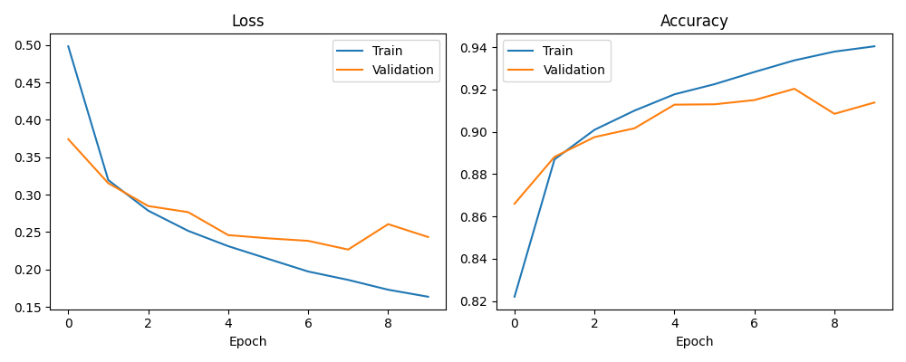
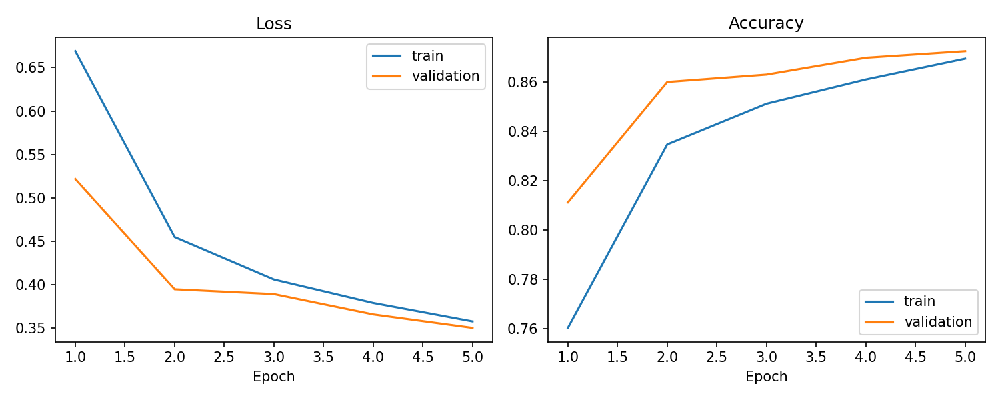
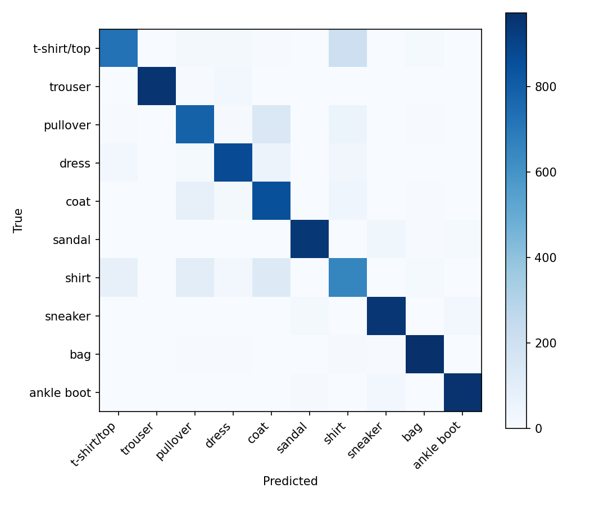

# Báo cáo thực nghiệm E1 và E2

**Môn học:** Deep Learning and Its Applications in Computer Vision — CO5085

**Sinh viên:** Trần Thái Học (MSSV 2570426; theo thông tin trong các tệp của repository)

**Ngày nộp:** 26 tháng 10 năm 2026

**Trạng thái báo cáo:** Báo cáo tổng hợp dựa trên các tư liệu hiện có trong repository

> **Tình trạng tài liệu đặc tả.** Trong quá trình kiểm tra, không tìm thấy PDF đề bài E1/E2 chính thức, `exercise-vne.pdf` hoặc rubric chấm điểm trong repository, các branch đã theo dõi hay thư mục bài tập lân cận. Vì vậy, báo cáo mô tả phần công việc đã triển khai và các yêu cầu được ghi nhận trong repository; báo cáo không khẳng định đã đối chiếu đầy đủ với tài liệu đặc tả chính thức chưa có.

## Mục lục

- [Tóm tắt](#tóm-tắt)
- [1. Giới thiệu](#1-giới-thiệu)
- [2. Yêu cầu và phương pháp thực nghiệm](#2-yêu-cầu-và-phương-pháp-thực-nghiệm)
- [3. E1: Triển khai và kết quả thực nghiệm](#3-e1-triển-khai-và-kết-quả-thực-nghiệm)
- [4. E2: Triển khai và kết quả thực nghiệm](#4-e2-triển-khai-và-kết-quả-thực-nghiệm)
- [5. Phân tích so sánh](#5-phân-tích-so-sánh)
- [6. Thảo luận và hạn chế](#6-thảo-luận-và-hạn-chế)
- [7. Kết luận và công việc tiếp theo](#7-kết-luận-và-công-việc-tiếp-theo)
- [Tài liệu tham khảo](#tài-liệu-tham-khảo)
- [Phụ lục A: Bằng chứng và khả năng tái lập](#phụ-lục-a-bằng-chứng-và-khả-năng-tái-lập)

## Tóm tắt

E1 so sánh các bộ phân loại Softmax, multilayer perceptron (MLP) và
convolutional neural network (CNN) trên Fashion-MNIST. Repository có mã
training, notebook Colab, model checkpoint, tư liệu kết quả và phân tích trực
quan. CSV so sánh hiện tại cùng các bản ghi JSON tương ứng cho thấy test
accuracy lần lượt là 84.19% (Softmax), 87.92% (MLP) và 91.11% (CNN). Trong
các lần chạy này, CNN có ít parameters hơn MLP nhưng nhiều hơn Softmax. Những
quan sát này chỉ mô tả các lần chạy đã lưu, không phải bằng chứng về ý nghĩa
thống kê qua nhiều seed.

E2 so sánh module Multi-Head Self-Attention (MSA) tự hiện thực với
`nn.MultiheadAttention` của PyTorch, đồng thời đánh giá patch, row và CNN-stem
tokenization trong một image classifier nhỏ dựa trên Transformer. Các lần chạy
chính đã lưu có test accuracy từ 85.47% đến 86.65%. Row tokenization có test
accuracy cao nhất trong ba lần chạy tokenization; trong so sánh riêng về cách
hiện thực attention, biến thể PyTorch nhỉnh hơn custom MSA. Mỗi cấu hình chỉ
có một lần chạy được ghi nhận.

Cấu hình mặc định được tài liệu hóa của cả hai bài đều sử dụng Fashion-MNIST,
seed 42, validation split 10% và batch size 128. Lịch training, optimizer và
architecture khác nhau, do đó so sánh trực tiếp E1 với E2 chỉ mang tính mô tả,
không phải so sánh đối đầu có kiểm soát. Ngoài ra, vẫn còn sai khác trong báo
cáo: `E1/results/analysis.md` chứa các giá trị accuracy/time cũ, không khớp
với tư liệu CSV/JSON E1 hiện tại. Các bảng định lượng bên dưới sử dụng CSV so
sánh hiện tại và các tệp JSON model nhất quán với nhau.

## 1. Giới thiệu

E1 khảo sát image classification bằng ba thiết kế bộ phân loại có mức độ phức
tạp khác nhau: linear classifier trên ảnh đã flatten, MLP và CNN. E2 mở rộng
các thực nghiệm ảnh nhỏ trong repository sang image classification dựa trên
attention, tập trung vào việc hiện thực MSA và so sánh các chiến lược image
tokenization.

Mô tả dự án và README trong repository xác định Fashion-MNIST là dataset mặc
định, đồng thời nêu các phần triển khai và so sánh được trình bày dưới đây.
Không tìm thấy đặc tả chính thức của môn học hoặc rubric chấm điểm trong
repository đã kiểm tra hay các tệp bài tập lân cận. Do đó, đánh giá mức độ hoàn
thành trong báo cáo này chỉ dựa trên bằng chứng trong repository và không thể
xác nhận đáp ứng các yêu cầu bổ sung có thể chỉ xuất hiện trên LMS của môn học
hoặc trong PDF chưa tìm thấy.

## 2. Yêu cầu và phương pháp thực nghiệm

### 2.1 Dataset và protocol dữ liệu dùng chung

Cả hai cấu hình mặc định đều chọn Fashion-MNIST, một dataset ảnh grayscale có
10 lớp, kích thước ảnh `1 × 28 × 28`. Code hỗ trợ MNIST và CIFAR-10 làm lựa
chọn thay thế, nhưng các bản ghi thực nghiệm E1/E2 đã lưu xác định
Fashion-MNIST là dataset được sử dụng.

Code dataset áp dụng `ToTensor`, sau đó normalization theo từng channel với
mean `0.5` và standard deviation `0.5` cho dataset grayscale. Training split
được chia thành tập training và validation bằng random split có seed, với
validation fraction `0.1`; test set gốc được nạp riêng. Seed mặc định là `42`,
và cả hai cấu hình mặc định đều đặt batch size bằng `128`.

Training set Fashion-MNIST có 60.000 ảnh; với split 10% đã cấu hình, số lượng
dự kiến là 54.000 ảnh training và 6.000 ảnh validation. Test set tiêu chuẩn có
10.000 ảnh. Code thể hiện phép chia và các tham số; những số lượng này được
tính từ định nghĩa dataset và tỷ lệ đã cấu hình, không phải metric được ghi
nhận riêng cho từng lần chạy.

### 2.2 Môi trường thực thi và định nghĩa metric

Các tệp metric JSON riêng lẻ của E2 ghi nhận thiết bị thực thi là CUDA và
README mô tả kết quả được tạo trên Google Colab. CSV so sánh và các tệp metric
JSON E1 hiện tại không ghi lại thiết bị đã dùng cho những lần chạy được báo
cáo; README E1 mô tả cơ chế tự chọn thiết bị nhưng không xác nhận thiết bị cho
các kết quả cụ thể đã lưu này.

Cả hai phần evaluation đều tính accuracy bằng tỷ lệ dự đoán chính xác. Best
validation accuracy được báo cáo là validation accuracy cao nhất trong lần
chạy đã lưu; code training của E2 chọn checkpoint tốt nhất theo validation
accuracy. E1 cũng lưu confusion matrix và ví dụ dự đoán sai. E2 lưu confusion
matrix và inference time. Macro-F1 không có trong các bảng kết quả hoặc tư
liệu metric JSON đã kiểm tra.

## 3. E1: Triển khai và kết quả thực nghiệm

### 3.1 Mục tiêu và triển khai

E1 so sánh ba bộ phân loại trên cùng một bài toán image classification:

- **Softmax classifier:** flatten ảnh rồi áp dụng một linear layer để tạo class
  logits. Phần triển khai trả về logits; criterion khi training là
  cross-entropy.
- **MLP:** flatten ảnh, áp dụng các hidden layer fully connected với activation
  ReLU, sau đó ánh xạ thành class logits.
- **CNN:** sử dụng hai convolutional block, mỗi block gồm convolution `3 × 3`,
  ReLU và max pooling `2 × 2`, tiếp theo là classification head trên vector
  đã flatten.

Cấu hình mặc định trong repository sử dụng hidden dimensions `[128, 64]` cho
MLP, channels `[32, 64]` cho CNN và dropout `0.0`. Code training E1 hiện thực
training loop gồm forward/loss/backward/optimizer và validation pass; các tư
liệu thực nghiệm đã lưu xác nhận những model này đã được training và evaluation.

### 3.2 Dataset và thiết lập training

Kết quả E1 đã lưu và cấu hình mặc định ghi nhận:

| Thiết lập | Giá trị được ghi nhận/mặc định |
|---|---|
| Dataset | Fashion-MNIST |
| Seed | 42 |
| Validation fraction | 0.1 |
| Optimizer | Adam |
| Learning rate | 0.001 |
| Batch size | 128 |
| Epochs | 10 |
| Input normalization | Mean 0.5, standard deviation 0.5 |
| Thiết bị chạy | Không được ghi trong tư liệu metric E1 hiện tại |

Cấu hình ghi lại thiết lập mặc định dự kiến. Các tệp CSV và JSON là bằng
chứng cho kết quả đo; snapshot cấu hình chính xác theo từng lần chạy không có
cùng các metric trong thư mục output E1 đã kiểm tra.

### 3.3 Kết quả định lượng đã xác minh

Các giá trị dưới đây được lấy từ
[`E1/results/metrics/model_comparison.csv`](../E1/results/metrics/model_comparison.csv)
và đối chiếu với
[`E1/results/metrics.json`](../E1/results/metrics.json) và các tệp JSON của
từng model. Accuracy được biểu thị theo phần trăm; thời gian được làm tròn đến
hai chữ số thập phân từ giá trị giây đã lưu.

| Model | Best validation accuracy | Test accuracy | Số parameters | Training time (giây) |
|---|---:|---:|---:|---:|
| Softmax | 85.25% | 84.19% | 7,850 | 104.96 |
| MLP | 88.67% | 87.92% | 109,386 | 106.99 |
| CNN | 92.03% | 91.11% | 50,186 | 112.99 |

Các tư liệu metric không báo cáo confidence interval, thống kê qua nhiều seed,
Macro-F1 hoặc inference time cho E1. Thời gian được ghi nhận chỉ áp dụng cho
các lần chạy đã lưu trong điều kiện runtime chưa được tài liệu hóa.

### 3.4 Phân tích kết quả

Trong các lần chạy được ghi nhận, test accuracy tăng theo thứ tự từ Softmax
đến MLP rồi CNN. So với Softmax, MLP cao hơn 3.73 điểm phần trăm và CNN cao
hơn 6.92 điểm phần trăm. CNN cao hơn MLP 3.19 điểm phần trăm. CNN có 50,186
parameters, ít hơn 109,386 của MLP nhưng nhiều hơn 7,850 của Softmax. Thời gian
các lần chạy đã lưu nằm trong khoảng 104.96 đến 112.99 giây.

Các so sánh này chỉ mang tính mô tả, với một lần chạy được báo cáo cho mỗi
model. Chúng không tách biệt ảnh hưởng của architecture qua nhiều seed hoặc
xác lập ý nghĩa thống kê. Tài liệu phân tích nêu định tính sự nhầm lẫn giữa
các lớp Fashion-MNIST có hình ảnh tương tự và thảo luận khoảng cách train/
validation có thể có; đây là các quan sát từ biểu đồ và ví dụ đã lưu, không
phải so sánh định lượng theo từng lớp trong báo cáo này.

**Hình 1.** Learning curve của E1 thể hiện loss và accuracy trên tập
training/validation qua 10 epoch được ghi nhận cho Softmax, MLP và CNN.

**Hình 2.** Confusion matrix của CNN trong E1 tổng hợp dự đoán đúng và sai
theo từng lớp Fashion-MNIST trên test set.

Repository cũng có learning curve, confusion matrix và hình minh họa các ví dụ
dự đoán sai cho Softmax và MLP tại
[`E1/results/figures/`](../E1/results/figures/).

### 3.5 Đánh giá yêu cầu và mức độ hoàn thành

Bằng chứng trong repository xác nhận cả ba bộ phân loại đã được triển khai và
có kết quả chạy được lưu, cùng với pipeline nạp/chia dataset dùng chung,
training, evaluation và tư liệu phân tích lỗi định tính. Không thể đánh giá
chính thức theo rubric E1 vì chưa tìm thấy tài liệu này. Sai khác trong báo cáo
kết quả được mô tả tại [Mục 6](#6-thảo-luận-và-hạn-chế) cũng cho thấy cần đối
chiếu tài liệu phân tích E1 hiện có với metric hiện tại trước khi xem đó là
nội dung tường thuật duy nhất có thẩm quyền.

## 4. E2: Triển khai và kết quả thực nghiệm

### 4.1 Mục tiêu và phương pháp

E2 triển khai một image classifier gọn nhẹ gồm image tokenization, class token,
positional embedding, các encoder block nông chứa MSA và feed-forward network,
cùng classification head. Đây là một Transformer-style classifier mang tính
thực nghiệm cho ảnh nhỏ; repository không mô tả model này là Vision Transformer
pretrained quy mô đầy đủ.

Phần so sánh attention sử dụng:

- **Custom MSA:** các linear projection riêng cho Query, Key và Value; scaled
  dot-product attention; softmax; tổng hợp Value có trọng số; nối các head và
  output projection.
- **PyTorch MSA:** `nn.MultiheadAttention` với `batch_first=True`.

Phần so sánh tokenization sử dụng:

- **Patch:** các patch `7 × 7` không chồng lấp; ảnh Fashion-MNIST `28 × 28`
  tạo thành 16 patch token.
- **Row:** mỗi hàng ảnh tương ứng một token; tổng cộng 28 token.
- **CNN-stem:** convolutional stem nhỏ, trong đó các vị trí trên feature map
  trở thành token; tạo 49 token với input Fashion-MNIST đã tài liệu hóa.

### 4.2 Dataset và thiết lập training

E2 tuân theo thiết lập Fashion-MNIST dùng chung: seed `42`, validation
fraction `0.1`, batch size `128` và normalization với mean/std `0.5`. Cấu hình
mặc định sử dụng AdamW với weight decay `0.0001`, learning rate `0.001`, năm epoch,
embedding dimension `64`, bốn attention head, hai encoder block, dropout
`0.1` và MLP ratio `2.0`. Các tệp JSON kết quả chính ghi nhận CUDA là thiết bị
thực thi.

Trong các phép so sánh, attention type và tokenizer được thay đổi theo tên thí
nghiệm, còn các thiết lập model/training khác được giữ chung. Các tệp thực
nghiệm đã ghi nhận không bao gồm lần chạy lặp hoặc ước lượng độ bất định.

### 4.3 Kết quả định lượng đã xác minh

Các lần chạy chính dưới đây được lấy từ
[`E2/outputs/metrics/comparison.csv`](../E2/outputs/metrics/comparison.csv),
và được đối chiếu với các tệp JSON tương ứng. Validation accuracy và test
accuracy được báo cáo riêng. Accuracy hiển thị theo phần trăm; thời gian được
làm tròn đến hai chữ số thập phân từ giá trị giây đã lưu.

| Thí nghiệm | Attention | Tokenizer | Best validation accuracy | Test accuracy | Parameters | Training time (s) | Inference time (s) |
|---|---|---|---:|---:|---:|---:|---:|
| `msa_custom_patch` | Custom | Patch | 85.82% | 85.47% | 72,074 | 65.22 | 1.92 |
| `msa_torch_patch` | PyTorch | Patch | 85.92% | 85.67% | 72,074 | 63.68 | 1.90 |
| `tok_patch_custom` | Custom | Patch | 85.82% | 85.47% | 72,074 | 64.28 | 1.91 |
| `tok_row_custom` | Custom | Row | 87.25% | 86.65% | 71,498 | 65.37 | 1.92 |
| `tok_cnn_stem_custom` | Custom | CNN-stem | 86.90% | 86.07% | 89,802 | 66.89 | 1.98 |

Bản ghi `smoke_custom_patch` riêng báo cáo best validation accuracy 86.27%,
test accuracy 85.71%, 72,074 parameters, training time 82.55 giây và inference
time 2.26 giây. Đây là bản ghi smoke test, không thuộc các phép so sánh chính
năm epoch; bản ghi đã lưu tương ứng không nêu số epoch nên báo cáo này không
suy diễn thông tin đó.

Không tìm thấy Macro-F1, confidence interval, thống kê tổng hợp qua nhiều seed
hoặc bảng precision/recall theo lớp trong tư liệu metric E2.

### 4.4 Phân tích kết quả

Trong phép so sánh cách hiện thực attention với patch tokenization, PyTorch
MSA đạt test accuracy 85.67%, còn custom MSA đạt 85.47%, chênh lệch 0.20 điểm
phần trăm giữa hai lần chạy riêng lẻ này. Số parameters của hai model bằng
nhau; thời gian được lưu cũng gần nhau. Khác biệt nhỏ từ một lần chạy này
không chứng minh một cách hiện thực luôn vượt trội hơn.

Với custom MSA, row tokenization có test accuracy cao nhất trong ba lần chạy
tokenization (86.65%), tiếp theo là CNN-stem (86.07%) và patch (85.47%).
CNN-stem có số parameters lớn nhất trong ba lần chạy này (89,802); row có
71,498 parameters và patch có 72,074. Training time và inference time được
ghi nhận khá gần nhau, nhưng các số đo thời gian chỉ áp dụng cho những lần
chạy CUDA đã lưu.

**Hình 3.** Learning curve E2 của lần chạy row-tokenization với custom MSA thể
hiện loss và accuracy qua các epoch training được ghi nhận.

**Hình 4.** Confusion matrix của row-tokenization thể hiện dự đoán trên test
set theo từng lớp Fashion-MNIST trong thí nghiệm `tok_row_custom`.

### 4.5 Đánh giá yêu cầu và mức độ hoàn thành

Bằng chứng trong repository xác nhận các cách hiện thực custom và PyTorch
MSA, image classifier nhỏ dựa trên attention, ba tokenizer, automated test,
notebook, metric và biểu đồ đã lưu. README tài liệu hóa các phép so sánh giữa
các cách hiện thực attention và các biến thể tokenization. Nếu không có đặc
tả chính thức thì không thể xác minh liệu đề bài có yêu cầu thêm phép so sánh,
định dạng báo cáo cụ thể hoặc deliverable bổ sung hay không.

## 5. Phân tích so sánh

E1 và E2 sử dụng cùng họ dataset, validation fraction, seed, batch size và
input normalization theo tài liệu. Tuy nhiên, câu hỏi thực nghiệm của hai bài
khác nhau:

- E1 so sánh ba nhóm classifier, bao gồm linear baseline và CNN thông thường.
- E2 so sánh hai cách hiện thực MSA với patch tokenizer cố định, sau đó so
  sánh ba tokenizer bằng custom MSA trong Transformer-style classifier gọn nhẹ.

E1 sử dụng Adam trong 10 epoch; E2 sử dụng AdamW có weight decay trong năm
epoch. Model và hệ thống được đo cũng khác nhau. Vì vậy, không nên diễn giải
test accuracy của E1 và E2 như thứ hạng có kiểm soát giữa CNN và Transformer.
Để đưa ra kết luận trực tiếp giữa các nhóm model cần thiết kế so sánh và ngân
sách training được cân bằng rõ ràng.

Trong các lần chạy E1 đã lưu, CNN có test accuracy cao nhất và ít parameters
hơn MLP. Trong các lần chạy so sánh tokenization của E2, row tokenization có
test accuracy được ghi nhận cao nhất. Đây là các phát hiện riêng theo từng
bài toán, không hàm ý CNN vượt trội hơn classifier của E2 hoặc row
tokenization luôn là lựa chọn tốt nhất.

## 6. Thảo luận và hạn chế

### 6.1 Các kết quả đo được

Tất cả giá trị trong các bảng đều lấy từ tư liệu CSV/JSON đã lưu. CSV so sánh
E1 hiện tại khớp với `E1/results/metrics.json` tổng hợp và các tệp JSON riêng
của Softmax, MLP và CNN. Các giá trị trong CSV so sánh E2 khớp với tư liệu
kết quả JSON riêng của năm lần chạy chính.

### 6.2 Sai khác trong báo cáo E1

[`E1/results/analysis.md`](../E1/results/analysis.md) báo cáo test accuracy của
Softmax, MLP và CNN lần lượt là 84.19%, 87.92% và 91.05%, cùng training time
118.44, 118.44 và 122.53 giây. Các giá trị này khác với tư liệu metric E1
hiện tại, lần lượt ghi nhận 84.19%, 87.92% và 91.11%, cùng 104.96, 106.99 và
112.99 giây. Thời gian đã làm tròn trong README (105.0, 107.0 và 113.0 giây)
khớp với CSV/JSON hiện tại. Điều này gợi ý tài liệu phân tích chứa kết quả từ
lần chạy trước; repository không lưu thông tin nguồn gốc lần chạy để xác định
nguyên nhân sai khác. Báo cáo này sử dụng các giá trị CSV/JSON nhất quán với
nhau và nêu rõ sai khác thay vì gộp kết quả của các lần chạy khác nhau.

### 6.3 Khả năng tái lập và phạm vi

- Các tệp metric E1 đã lưu không xác định thiết bị thực tế dùng cho những lần
  chạy được báo cáo. Các bản ghi riêng của E2 xác định thiết bị là CUDA.
- Mỗi cấu hình chính chỉ có một lần chạy với seed 42. Không có dữ liệu về độ
  biến thiên qua nhiều seed hoặc confidence interval.
- E1 và E2 sử dụng optimizer, ngân sách epoch, architecture và cách đo thời
  gian khác nhau. Vì vậy, không thể so sánh trực tiếp training time tuyệt đối
  giữa hai bài.
- Không có Macro-F1 trong metric thực nghiệm của cả hai bài. E1 có confusion
  matrix và ví dụ dự đoán sai; E2 có confusion matrix và learning curve, nhưng
  không tìm thấy tư liệu phân tích lỗi theo lớp riêng biệt dưới dạng văn bản.
- Có test accuracy, nhưng snapshot chính xác cấu hình theo từng lần chạy và
  thông tin đầy đủ về môi trường/phiên bản không được ghi nhất quán cho mọi tư
  liệu E1.
- Không có đặc tả chính thức và rubric chấm điểm trong repository đã kiểm tra.
  Vì vậy, không thể xác minh đầy đủ mức độ đáp ứng các yêu cầu chính thức.

## 7. Kết luận và công việc tiếp theo

Repository có các phép so sánh E1 đã được triển khai và chạy giữa Softmax,
MLP và CNN trên Fashion-MNIST, cùng các thực nghiệm E2 so sánh custom/PyTorch
MSA và patch/row/CNN-stem tokenization. Tư liệu đã lưu cho thấy CNN có test
accuracy E1 cao nhất trong ba model được ghi nhận; row tokenization có test
accuracy cao nhất trong ba biến thể tokenization của E2. Các kết luận này chỉ
áp dụng cho những lần chạy riêng lẻ đã báo cáo, không đưa ra thứ hạng
architecture trực tiếp giữa E1 và E2.

Trước khi xem các deliverable là bản cuối, cần đối chiếu tài liệu phân tích E1
với tư liệu metric hiện tại, đồng thời kiểm tra cả hai bài theo PDF/rubric
chính thức khi có. Công việc tiếp theo có thể gồm chạy lặp với nhiều seed, ghi
nhất quán môi trường và cấu hình, bổ sung Macro-F1 nếu được yêu cầu, và thiết
kế phép so sánh cân bằng nếu yêu cầu E2 chính thức đòi hỏi đối chiếu với
baseline của E1.

## Tài liệu tham khảo

1. Tài liệu và tư liệu E1 trong repository: [`E1/README.md`](../E1/README.md),
   [`E1/results/analysis.md`](../E1/results/analysis.md),
   [`E1/configs/config.yaml`](../E1/configs/config.yaml), và
   [`E1/results/metrics/`](../E1/results/metrics/).
2. Tài liệu và tư liệu E2 trong repository: [`E2/README.md`](../E2/README.md),
   [`E2/configs/default.yaml`](../E2/configs/default.yaml), và
   [`E2/outputs/metrics/`](../E2/outputs/metrics/).
3. Zalando Research, [repository dataset Fashion-MNIST](https://github.com/zalandoresearch/fashion-mnist).
4. PyTorch, [tài liệu `torch.nn.MultiheadAttention`](https://pytorch.org/docs/stable/generated/torch.nn.MultiheadAttention.html).
5. Torchvision, [tài liệu dataset FashionMNIST](https://pytorch.org/vision/stable/generated/torchvision.datasets.FashionMNIST.html).

## Phụ lục A: Bằng chứng và khả năng tái lập

### A.1 Các tệp bằng chứng chính

| Bằng chứng | Đường dẫn trong repository |
|---|---|
| Định nghĩa model E1 | [`E1/src/models.py`](../E1/src/models.py) |
| Nạp dữ liệu, chia split và transforms E1 | [`E1/src/datasets.py`](../E1/src/datasets.py) |
| Training loop E1 | [`E1/src/train.py`](../E1/src/train.py) |
| Evaluation và thu thập lỗi E1 | [`E1/src/evaluate.py`](../E1/src/evaluate.py) |
| Notebook E1 | [`E1/notebooks/E1_experiment.ipynb`](../E1/notebooks/E1_experiment.ipynb) |
| CSV so sánh và JSON tổng hợp E1 | [`E1/results/metrics/model_comparison.csv`](../E1/results/metrics/model_comparison.csv), [`E1/results/metrics.json`](../E1/results/metrics.json) |
| Module attention E2 | [`E2/src/attention.py`](../E2/src/attention.py) |
| Tokenizer và classifier E2 | [`E2/src/tokenizers.py`](../E2/src/tokenizers.py), [`E2/src/model.py`](../E2/src/model.py) |
| Pipeline dữ liệu và evaluator E2 | [`E2/src/data.py`](../E2/src/data.py), [`E2/src/evaluate.py`](../E2/src/evaluate.py) |
| Code training và test E2 | [`E2/src/train.py`](../E2/src/train.py), [`E2/tests/`](../E2/tests/) |
| Notebook và CSV so sánh E2 | [`E2/notebooks/e2_experiments.ipynb`](../E2/notebooks/e2_experiments.ipynb), [`E2/outputs/metrics/comparison.csv`](../E2/outputs/metrics/comparison.csv) |

### A.2 Nguồn gốc metric

| Bài tập | Kết quả | Bằng chứng chính | Đối chiếu |
|---|---|---|---|
| E1 | Test accuracy, best validation accuracy, số parameters và training time của từng classifier | `E1/results/metrics/model_comparison.csv` | `E1/results/metrics.json` và `E1/results/metrics/{softmax,mlp,cnn}.json` |
| E2 | Test accuracy, best validation accuracy, số parameters, training time và inference time của năm lần chạy chính | `E2/outputs/metrics/comparison.csv` | Các tệp JSON riêng tương ứng trong `E2/outputs/metrics/` |
| E2 smoke test | Một bản ghi smoke test đã lưu, được tách riêng khỏi các phép so sánh chính | `E2/outputs/metrics/smoke_custom_patch.json` | `E2/outputs/metrics/comparison.csv` |
