# BÁO CÁO BÀI TẬP E1–E3

**Môn học:** CO5085 – Deep Learning and Its Applications in Computer Vision  
**Trường:** Ho Chi Minh City University of Technology – VNU-HCM  
**Giảng viên hướng dẫn:** Lê Thành Sách  
**Sinh viên:** Trần Thái Học – 2570426  
**Học kỳ:** 261 (2026–2027)  
**Tiêu đề:** Exercises E1–E3

## Mục lục

1. [Giới thiệu](#1-giới-thiệu)
2. [Dataset và thiết lập thực nghiệm](#2-dataset-và-thiết-lập-thực-nghiệm)
3. [E1 – Softmax, MLP và CNN](#3-e1--softmax-mlp-và-cnn)
4. [E2 – Transformer và Multi-Head Self-Attention](#4-e2--transformer-và-multi-head-self-attention)
5. [E3 – LSTM và GRU](#5-e3--lstm-và-gru)
6. [So sánh tổng hợp E1–E3](#6-so-sánh-tổng-hợp-e1e3)
7. [Kết luận và hướng cải thiện](#7-kết-luận-và-hướng-cải-thiện)
8. [Tài liệu tham khảo và khả năng tái lập](#8-tài-liệu-tham-khảo-và-khả-năng-tái-lập)

## 1. Giới thiệu

Trong ba bài tập này, em khảo sát các phương pháp phân loại ảnh Fashion-MNIST dựa trên những kiến trúc khác nhau. E1 so sánh bộ phân loại tuyến tính, MLP và CNN. E2 tập trung vào Transformer ảnh nhỏ, gồm hai cách cài đặt Multi-Head Self-Attention (MSA) và ba phương pháp tokenization. E3 biểu diễn ảnh thành chuỗi hàng pixel để huấn luyện LSTM và GRU.

Các thí nghiệm cùng sử dụng bài toán phân loại 10 lớp, nhưng khác nhau về số epoch và optimizer: E1 và E3 huấn luyện 10 epoch với Adam, còn E2 huấn luyện 5 epoch với AdamW. Những khác biệt này cần được cân nhắc khi đối chiếu kết quả giữa các bài.

## 2. Dataset và thiết lập thực nghiệm

### 2.1. Fashion-MNIST và tiền xử lý

Fashion-MNIST gồm ảnh grayscale kích thước `28 × 28`, thuộc 10 nhãn: T-shirt/top, trouser, pullover, dress, coat, sandal, shirt, sneaker, bag và ankle boot. Tập huấn luyện ban đầu gồm 60.000 ảnh, được chia thành 54.000 ảnh train và 6.000 ảnh validation; 10.000 ảnh test được giữ riêng. Ảnh được chuyển thành tensor và chuẩn hóa với mean, standard deviation bằng `0.5`, đưa giá trị pixel về khoảng `[-1, 1]`.

E3 sử dụng chung data loader với E1, do đó giữ cùng quy tắc tiền xử lý và chia tập. Cả ba bài đặt seed `42` để cố định quá trình chia dữ liệu và khởi tạo ngẫu nhiên.

### 2.2. Cấu hình và pipeline

**Bảng 1. Cấu hình huấn luyện của ba bài**

| Thuộc tính | E1 | E2 | E3 |
|---|---:|---:|---:|
| Dataset | Fashion-MNIST | Fashion-MNIST | Fashion-MNIST |
| Seed | 42 | 42 | 42 |
| Validation split | 10% | 10% | 10% |
| Batch size | 128 | 128 | 128 |
| Epochs | 10 | 5 | 10 |
| Learning rate | 0.001 | 0.001 | 0.001 |
| Optimizer | Adam | AdamW (`weight_decay=0.0001`) | Adam (`weight_decay=0`) |
| Loss | Cross-entropy | Cross-entropy | Cross-entropy |

Các mô hình được tối ưu trên tập train, theo dõi loss và accuracy trên tập validation, sau đó đánh giá trên tập test. Với E3, checkpoint được chọn theo validation accuracy; tập test chỉ được dùng ở bước đánh giá cuối.

### 2.3. Môi trường và đơn vị đo

Thông tin thí nghiệm E2 ghi nhận thiết bị `cuda`, nhưng không nêu model GPU hoặc phiên bản phần mềm. Thông tin phần cứng của E1 và E3 cũng không có trong kết quả lưu trữ. Vì vậy, thời gian huấn luyện dưới đây chỉ mô tả từng lần chạy, không được dùng để xếp hạng tốc độ giữa các bài.

Trong E2, `inference_time` là thời gian chạy toàn bộ vòng đánh giá trên test set, gồm dự đoán và lập confusion matrix. Chỉ số này không phải latency của một lượt forward đơn lẻ.

## 3. E1 – Softmax, MLP và CNN

### 3.1. Mục tiêu và kiến trúc

Ở E1, em so sánh bộ phân loại tuyến tính với hai mô hình phi tuyến:

**Bảng 2. Kiến trúc và số tham số của các mô hình E1**

| Mô hình | Kiến trúc | Số tham số |
|---|---|---:|
| Softmax | Flatten `1 × 28 × 28` thành 784 đặc trưng, Linear `784 → 10` tạo logits | 7,850 |
| MLP | Flatten, Linear `784 → 128 → 64 → 10`, ReLU giữa các lớp; dropout bằng 0 | 109,386 |
| CNN | Conv `1 → 32`, ReLU, MaxPool `2 × 2`; Conv `32 → 64`, ReLU, MaxPool; flatten `64 × 7 × 7`, Linear `3136 → 10` | 50,186 |

Cả ba mô hình trả về logits và được huấn luyện bằng cross-entropy. Với bộ phân loại tuyến tính, phép Softmax được xử lý trong loss function thay vì áp dụng tường minh ở đầu ra. Các cấu hình dùng Adam, learning rate `0.001`, batch size `128`, 10 epoch, seed `42` và validation split `10%`.

### 3.2. Kết quả

Bảng 3 trình bày metric train và validation ở epoch cuối, cùng với best validation accuracy trong quá trình huấn luyện. Loss được làm tròn đến bốn chữ số thập phân; accuracy được làm tròn đến hai chữ số phần trăm.

**Bảng 3. Kết quả phân loại của Softmax, MLP và CNN**

| Mô hình | Train loss cuối | Train accuracy cuối | Validation loss cuối | Validation accuracy cuối | Best validation accuracy (epoch) | Test accuracy | Tham số | Training time (s) |
|---|---:|---:|---:|---:|---:|---:|---:|---:|
| Softmax | 0.3987 | 86.11% | 0.4333 | 85.25% | 85.25% (10) | 84.19% | 7,850 | 111.59 |
| MLP | 0.2460 | 90.83% | 0.3221 | 88.60% | 88.67% (9) | 87.92% | 109,386 | 113.41 |
| CNN | 0.1627 | 94.15% | 0.2382 | 91.52% | 91.93% (8) | **91.22%** | 50,186 | 124.08 |

CNN đạt test accuracy cao nhất, hơn MLP `3.30` điểm phần trăm và hơn Softmax `7.03` điểm phần trăm. Dù có ít hơn 59.200 tham số so với MLP, CNN vẫn cho kết quả cao hơn. Softmax có số tham số thấp nhất nhưng cũng đạt test accuracy thấp nhất.

### 3.3. Learning curves và phân tích hội tụ

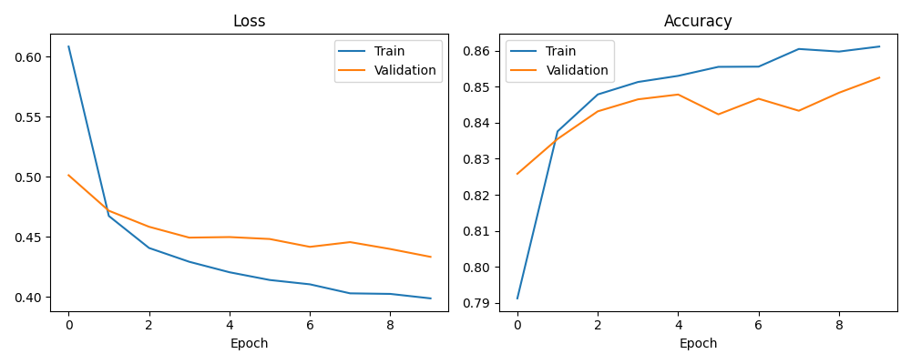

*Hình 1. Loss và accuracy trên tập train, validation của Softmax qua 10 epoch.*

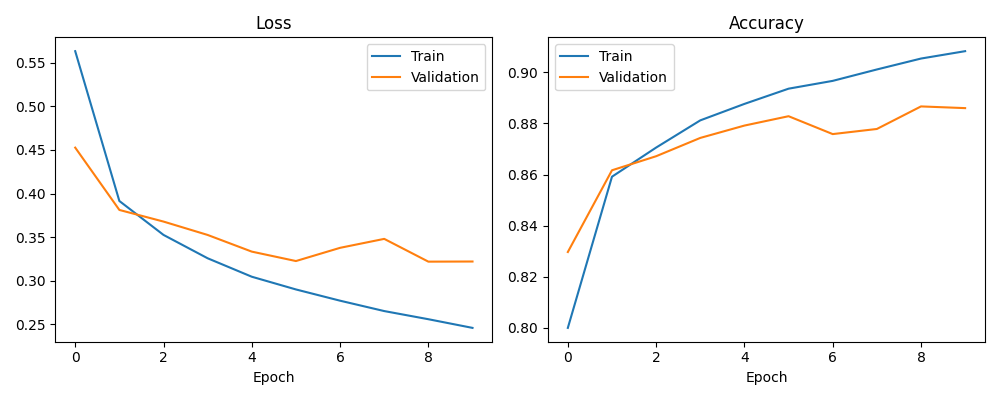

*Hình 2. Loss và accuracy trên tập train, validation của MLP. Validation accuracy cao nhất đạt 88.67% ở epoch 9.*

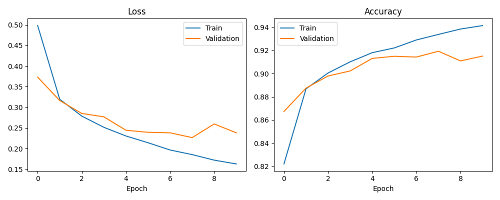

*Hình 3. Loss và accuracy trên tập train, validation của CNN. Validation accuracy cao nhất (91.93%) và validation loss thấp nhất (0.2266) cùng xuất hiện ở epoch 8.*

Ở cả ba mô hình, train loss giảm trong khi train accuracy tăng. Với CNN, validation loss thấp nhất ở epoch 8 rồi tăng ở epoch 9; đồng thời khoảng cách giữa train và validation accuracy ở cuối quá trình là 2.63 điểm phần trăm. Diễn biến này gợi ý khả năng overfitting nhẹ ở các epoch cuối, nhưng cần thêm lần chạy để khẳng định xu hướng.

### 3.4. Confusion matrix và mẫu dự đoán sai

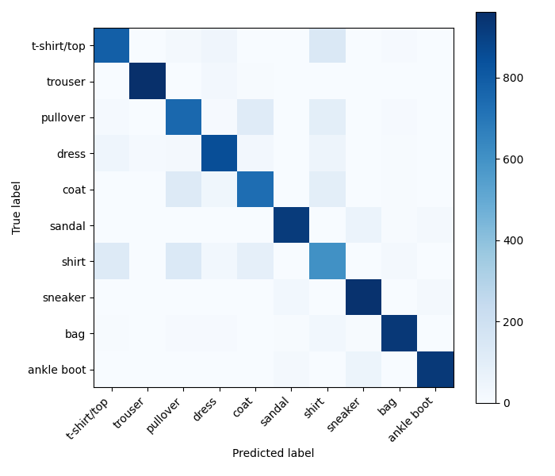

*Hình 4. Confusion matrix của Softmax trên test set; hàng là nhãn thật, cột là nhãn dự đoán.*

*Hình 5. Confusion matrix của MLP trên test set; hàng là nhãn thật, cột là nhãn dự đoán.*

*Hình 6. Confusion matrix của CNN trên test set; hàng là nhãn thật, cột là nhãn dự đoán.*

Các lớp được dự đoán đúng tập trung chủ yếu trên đường chéo chính. Trong các ví dụ phân loại sai, mô hình thường nhầm lẫn giữa những loại áo có hình dáng tương tự, chẳng hạn shirt, T-shirt/top, pullover và coat.

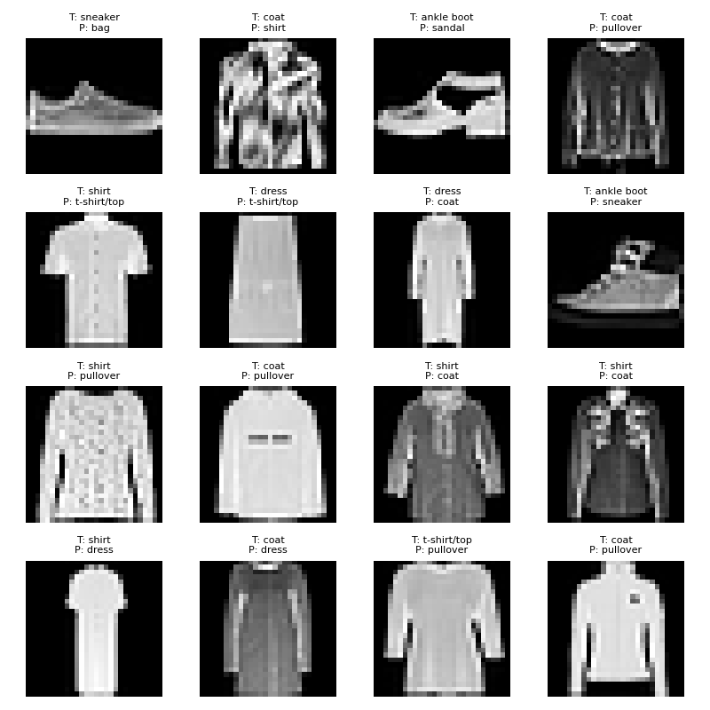

*Hình 7. Một số ảnh test bị CNN phân loại sai; nhãn thật (T) và nhãn dự đoán (P) được ghi phía trên mỗi ảnh.*

Các hình phân loại sai của Softmax và MLP cũng được lưu trong thư mục kết quả E1.

### 3.5. Nhận xét và kết luận E1

Trong ba mô hình, CNN đạt kết quả tốt nhất với số tham số thấp hơn MLP. MLP cải thiện accuracy so với bộ phân loại tuyến tính, nhưng có số tham số lớn nhất. Kết quả phù hợp với khác biệt trong cách xử lý dữ liệu: Softmax và MLP nhận ảnh đã làm phẳng, trong khi CNN áp dụng các phép tích chập và pooling để xử lý cấu trúc không gian.

## 4. E2 – Transformer và Multi-Head Self-Attention

### 4.1. Mục tiêu và kiến trúc Transformer

Mô hình E2 chuyển ảnh thành các token, thêm `[CLS]` token và positional embedding, sau đó xử lý chuỗi qua hai Transformer encoder block. Biểu diễn của `[CLS]` được đưa vào lớp phân loại. Mỗi block gồm LayerNorm, MSA, residual connection và feed-forward network. Cấu hình dùng embedding dimension `64`, `4` attention heads, `2` blocks, dropout `0.1`, MLP ratio `2.0`, batch size `128`, 5 epoch và AdamW với learning rate `0.001`, weight decay `0.0001`.

### 4.2. Hai implementation MSA

- **Custom MSA:** các phép chiếu tuyến tính tạo Query, Key và Value. Sau khi tách thành bốn head, mỗi head tính `softmax(QKᵀ / √dₖ)V`; các đầu ra được ghép lại và chiếu tuyến tính. Input `(B, T, 64)` có dạng `(B, 4, T, 16)` sau khi tách head.
- **PyTorch MSA:** sử dụng `nn.MultiheadAttention(embed_dim=64, num_heads=4, batch_first=True)` với query, key và value cùng lấy từ chuỗi đầu vào. Hai implementation được so sánh với cùng cấu hình và patch tokenizer.

### 4.3. Tokenization

**Bảng 4. So sánh cách tạo token từ ảnh Fashion-MNIST**

| Phương pháp | Cách tạo token từ ảnh `1 × 28 × 28` | Số token | Kích thước trước projection | Tham số của cả mô hình |
|---|---|---:|---:|---:|
| Patch | Chia thành patch `7 × 7` không chồng lấp | 16 | 49 pixel/patch | 72,074 |
| Row | Mỗi hàng ngang là một token | 28 | 28 pixel/hàng | 71,498 |
| CNN-stem | Hai convolution stride 2 tạo feature map `7 × 7`; mỗi vị trí là một token | 49 | 64 kênh/vị trí | 89,802 |

Mỗi tokenizer chiếu các token sang embedding 64 chiều. Số tham số trong bảng là tổng tham số của mô hình.

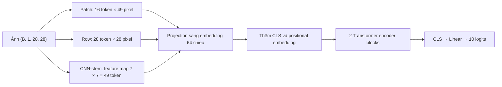

*Hình 8. Luồng xử lý ảnh của Transformer E2 với ba phương pháp tokenization.*

### 4.4. So sánh Custom MSA và PyTorch MSA

**Bảng 5. Kết quả so sánh hai implementation MSA với patch tokenizer**

| Experiment | MSA | Tokenizer | Test loss | Best validation accuracy | Test accuracy | Tham số | Training time (s) | Evaluation-loop time (s) |
|---|---|---|---:|---:|---:|---:|---:|---:|
| `msa_custom_patch` | Custom | Patch | 0.3995 | 85.82% | 85.47% | 72,074 | 65.22 | 1.92 |
| `msa_torch_patch` | PyTorch | Patch | 0.3974 | 85.92% | **85.67%** | 72,074 | 63.68 | 1.90 |

Với patch tokenizer, PyTorch MSA đạt test accuracy cao hơn Custom MSA `0.20` điểm phần trăm. Số tham số bằng nhau. Chênh lệch training time là khoảng 1.55 giây, còn evaluation-loop time chênh khoảng 0.02 giây. Do mỗi cấu hình chỉ được chạy một lần, các khác biệt nhỏ này chưa đủ để kết luận về ưu thế của một implementation.

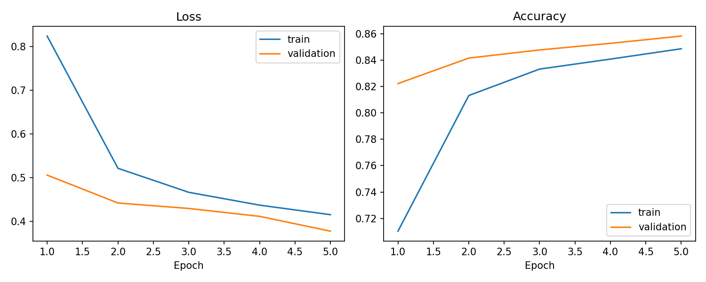

*Hình 9. Loss và accuracy trên tập train, validation của `msa_custom_patch`.*

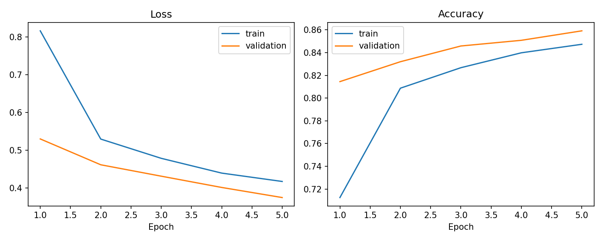

*Hình 10. Loss và accuracy trên tập train, validation của `msa_torch_patch`.*

*Hình 11. Confusion matrix của `msa_custom_patch`; hàng là nhãn thật, cột là nhãn dự đoán.*

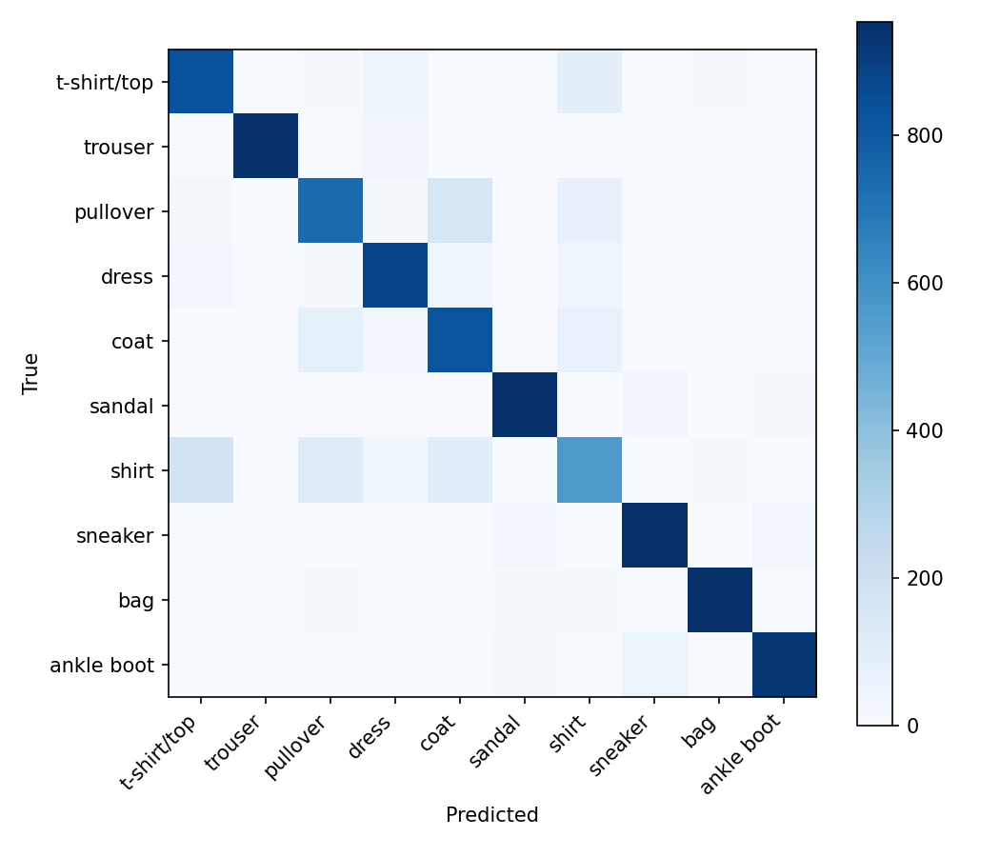

*Hình 12. Confusion matrix của `msa_torch_patch`; hàng là nhãn thật, cột là nhãn dự đoán.*

### 4.5. So sánh tokenization

Các cấu hình dưới đây sử dụng Custom MSA. Kết quả Patch lấy từ lần chạy `tok_patch_custom`, riêng với thí nghiệm so sánh MSA ở trên.

**Bảng 6. Kết quả so sánh ba phương pháp tokenization**

| Experiment | Tokenizer | Test loss | Best validation accuracy | Test accuracy | Tham số | Training time (s) | Evaluation-loop time (s) |
|---|---|---:|---:|---:|---:|---:|---:|
| `tok_patch_custom` | Patch | 0.3995 | 85.82% | 85.47% | 72,074 | 64.28 | 1.91 |
| `tok_row_custom` | Row | 0.3710 | **87.25%** | **86.65%** | **71,498** | 65.37 | 1.92 |
| `tok_cnn_stem_custom` | CNN-stem | 0.3821 | 86.90% | 86.07% | 89,802 | 66.89 | 1.98 |

Row đạt accuracy cao hơn Patch `1.18` điểm phần trăm và cao hơn CNN-stem `0.58` điểm phần trăm. Số tham số của Row thấp hơn Patch 576, trong khi CNN-stem có số tham số cao nhất. Kết quả không cho phép tách riêng ảnh hưởng của số token khỏi cách biểu diễn đặc trưng của từng tokenizer.

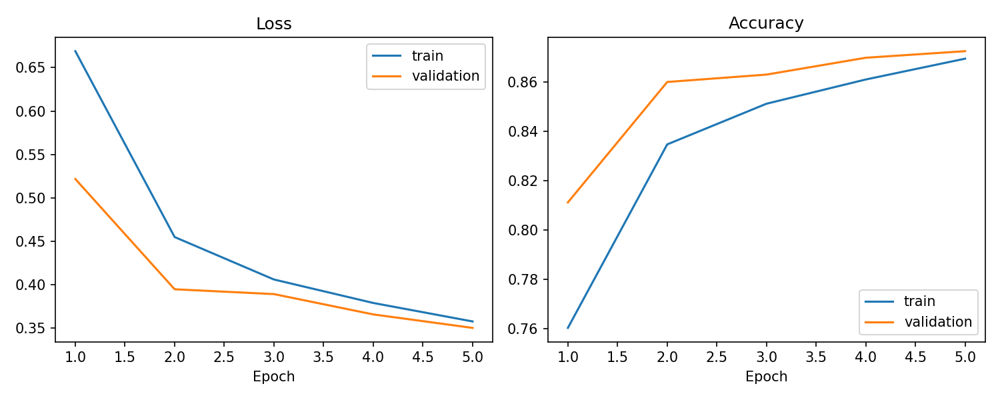

*Hình 13. Loss và accuracy trên tập train, validation của `tok_row_custom`.*

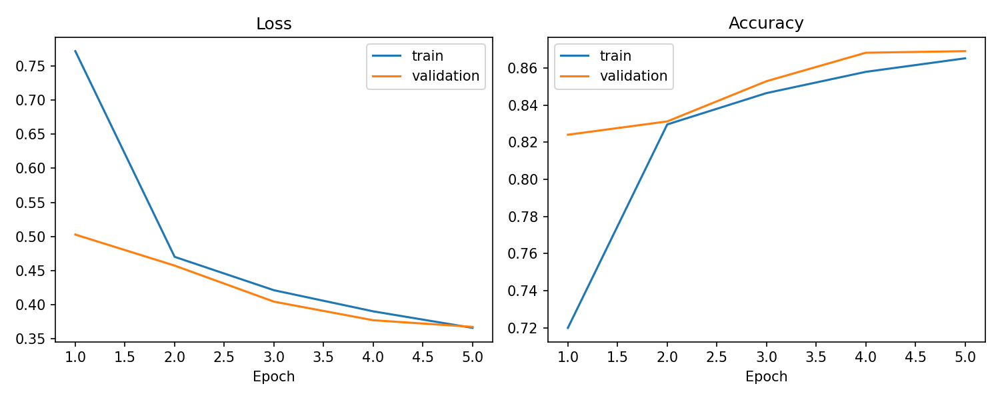

*Hình 14. Loss và accuracy trên tập train, validation của `tok_cnn_stem_custom`.*

Hình 8 minh họa cấu trúc token theo từng phương pháp; các đường cong huấn luyện và confusion matrix thể hiện kết quả tương ứng của từng cấu hình. Lần chạy `smoke_custom_patch` không được đưa vào so sánh vì đây là kiểm tra nhanh với mục tiêu khác.

### 4.6. Nhận xét và kết luận E2

Trong các cấu hình đã thử, Row đạt test accuracy cao nhất với số tham số thấp nhất. CNN-stem cao hơn Patch về accuracy nhưng có nhiều tham số hơn. Các kết quả này được thu từ một lần chạy với seed `42`, nên cần thận trọng khi khái quát hóa mức chênh lệch sang lần chạy khác.

## 5. E3 – LSTM và GRU

### 5.1. Chuyển ảnh thành chuỗi hàng

Hàm `image_to_row_sequence` nhận ảnh grayscale dạng `(B, 1, H, W)` và bỏ chiều kênh bằng `squeeze(1)`. Với Fashion-MNIST, tensor `(B, 1, 28, 28)` trở thành `(B, 28, 28)`: chuỗi có 28 bước từ trên xuống dưới, mỗi bước chứa 28 pixel của một hàng.

*Hình 15. Biểu diễn ảnh thành chuỗi hàng và các kích thước tensor trong E3.*

### 5.2. Kiến trúc và cấu hình huấn luyện

LSTM và GRU là các recurrent model một chiều với `input_size=28`, `hidden_size=128`, `num_layers=2` và dropout `0.2` giữa các lớp recurrent. Output ở bước thời gian cuối cùng có shape `(B, 128)`, sau đó được đưa qua lớp Linear `128 → 10`. Cả hai mô hình dùng Adam, cross-entropy, learning rate `0.001`, batch size `128`, 10 epoch, seed `42`, weight decay `0` và validation split `10%`. Checkpoint tốt nhất được chọn theo validation accuracy.

### 5.3. Kết quả LSTM và GRU

Các giá trị train và validation là metric ở epoch 10; cột best validation accuracy ghi lại giá trị cao nhất trong quá trình huấn luyện.

**Bảng 7. Kết quả thực nghiệm LSTM và GRU**

| Mô hình | Train loss cuối | Train accuracy cuối | Validation loss cuối | Validation accuracy cuối | Best validation accuracy (epoch) | Test loss | Test accuracy | Tham số | Training time (s) |
|---|---:|---:|---:|---:|---:|---:|---:|---:|---:|
| LSTM | 0.2501 | 90.72% | 0.2908 | 89.55% | 89.55% (9) | 0.3059 | 89.13% | 214,282 | 131.64 |
| GRU | 0.2325 | 91.33% | 0.2728 | 89.83% | **90.30% (9)** | **0.2839** | **90.09%** | **161,034** | **127.71** |

GRU cao hơn LSTM `0.96` điểm phần trăm về test accuracy, có test loss thấp hơn `0.0220` và ít hơn 53.248 tham số (khoảng 24.9%). Như vậy, trong thí nghiệm này, GRU cho kết quả tốt hơn LSTM ở cả ba tiêu chí.

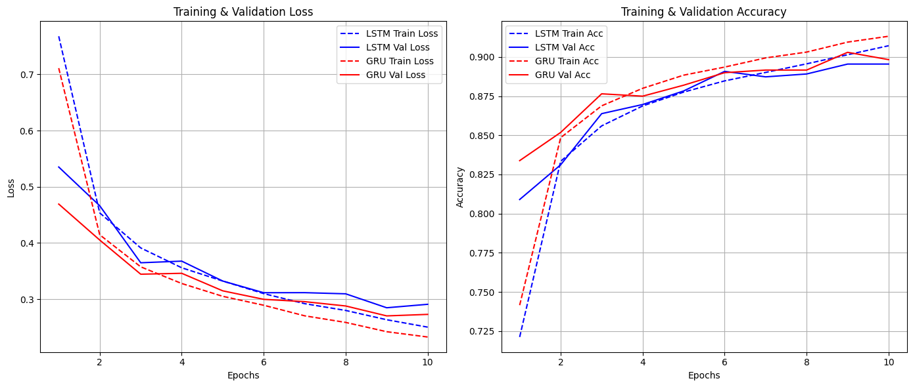

*Hình 16. Loss và accuracy trên tập train, validation của LSTM và GRU qua 10 epoch. Nét liền biểu diễn train, nét đứt biểu diễn validation.*

### 5.4. So sánh với baseline E1

**Bảng 8. So sánh test accuracy của các mô hình E1 và E3**

| Mô hình | Exercise | Test accuracy | Số tham số |
|---|---|---:|---:|
| MLP | E1 | 87.92% | 109,386 |
| CNN | E1 | **91.22%** | **50,186** |
| LSTM row-wise | E3 | 89.13% | 214,282 |
| GRU row-wise | E3 | 90.09% | 161,034 |

LSTM cao hơn MLP `1.21` điểm phần trăm và thấp hơn CNN `2.09` điểm phần trăm. GRU cao hơn MLP `2.17` điểm phần trăm nhưng thấp hơn CNN `1.13` điểm phần trăm. Cả hai recurrent model có nhiều tham số hơn CNN. E1 và E3 sử dụng cùng dataset, seed, cách chia tập, batch size, số epoch và optimizer; tuy nhiên, không có thông tin phần cứng để so sánh thời gian huấn luyện giữa hai bài.

### 5.5. Nhận xét và kết luận E3

Row-wise sequence giữ thứ tự các hàng theo chiều dọc; mô hình dùng output ở hàng cuối để tổng hợp thông tin của chuỗi. Với cách biểu diễn này, LSTM và GRU chưa vượt CNN baseline trên Fashion-MNIST. E3 hiện chỉ đánh giá row-wise sequence; các cách biểu diễn khác có thể được khảo sát trong những thí nghiệm tiếp theo.

## 6. So sánh tổng hợp E1–E3

Bảng 9 tổng hợp cấu hình có test accuracy cao nhất trong mỗi bài. Đây là các cấu hình đã được thử nghiệm, không phải kết quả của quá trình tìm kiếm siêu tham số toàn diện.

**Bảng 9. Cấu hình có test accuracy cao nhất trong mỗi bài**

| Exercise | Cấu hình tốt nhất đã thử | Test accuracy | Số tham số | Training time đã ghi (s) |
|---|---|---:|---:|---:|
| E1 | CNN | **91.22%** | **50,186** | 124.08 |
| E2 | Custom MSA + Row tokenizer | 86.65% | 71,498 | 65.37 |
| E3 | GRU row-wise | 90.09% | 161,034 | 127.71 |

CNN đạt test accuracy cao nhất và có ít tham số nhất trong ba cấu hình đứng đầu. Trong E3, GRU có kết quả cao hơn LSTM; trong E2, Row là tokenizer cho accuracy cao nhất. Tuy nhiên, E2 khác E1 và E3 về số epoch, optimizer và thông tin phần cứng. Do đó, thời gian huấn luyện không phản ánh trực tiếp tốc độ tương đối giữa các kiến trúc.

Các mô hình khai thác ảnh theo những cách khác nhau. Softmax và MLP làm phẳng ảnh thành vector; CNN sử dụng phép tích chập trên không gian hai chiều; Transformer học quan hệ giữa các token; LSTM và GRU xử lý chuỗi hàng theo thứ tự. Các thí nghiệm cho thấy sự khác nhau về accuracy và số tham số giữa những cấu hình cụ thể, nhưng chưa đủ để tách riêng ảnh hưởng của từng thành phần kiến trúc.

## 7. Kết luận và hướng cải thiện

Nhìn chung, CNN là mô hình có accuracy cao nhất trong các cấu hình đã khảo sát. Ở E2, Row tokenizer đạt kết quả cao hơn Patch và CNN-stem; ở E3, GRU vượt LSTM trong cấu hình row-wise. Mỗi cấu hình chỉ có một lần chạy nên chưa thể đánh giá độ biến thiên giữa các lần chạy. Thông tin phần cứng còn thiếu, và kết quả E3 chưa có confusion matrix hoặc hình các mẫu phân loại sai.

Trong các thí nghiệm tiếp theo, nên chạy nhiều seed và báo cáo giá trị trung bình cùng độ lệch chuẩn; đồng thời ghi lại cấu hình phần cứng, phần mềm và thống nhất điều kiện đo thời gian. Có thể bổ sung confusion matrix cho E3 và khảo sát thêm các cách biểu diễn ảnh thành chuỗi.

## 8. Tài liệu tham khảo và khả năng tái lập

### 8.1. Tài liệu và mã nguồn

- **Đề bài:** CO5085, Exercises E1–E3, học kỳ 261. Bản PDF đề bài không có trong tài liệu được cung cấp để đối chiếu trực tiếp.
- **Repository:** [deep-learning-computer-vision-co5085](https://github.com/hoctran19-cyber/deep-learning-computer-vision-co5085). Mã nguồn và kết quả E1/E2 nằm trên nhánh `main`; E3 được lưu trên nhánh `ex_3` và nội dung tương ứng đã có trong `main`.
- **Fashion-MNIST:** [Zalando Research – Fashion-MNIST](https://github.com/zalandoresearch/fashion-mnist).
- **E1:** [cấu hình](../E1/configs/config.yaml), [các mô hình](../E1/src/models.py), [dữ liệu và tiền xử lý](../E1/src/datasets.py), [metrics tổng hợp](../E1/results/metrics.json), [metrics theo mô hình](../E1/results/metrics/).
- **E2:** [cấu hình](../E2/configs/default.yaml), [MSA](../E2/src/attention.py), [tokenizers](../E2/src/tokenizers.py), [Transformer](../E2/src/model.py), [bảng so sánh](../E2/outputs/metrics/comparison.csv), [metrics chi tiết](../E2/outputs/metrics/).
- **E3:** [cấu hình](../E3/configs/config.yaml), [chuyển ảnh thành chuỗi](../E3/src/datasets.py), [các mô hình LSTM/GRU](../E3/src/models.py), [kết quả tổng hợp](../E3/results/metrics/experiment_results.csv), [LSTM history](../E3/results/metrics/lstm_history.json), [GRU history](../E3/results/metrics/gru_history.json).

### 8.2. Khai báo sử dụng công cụ AI

Công cụ AI được sử dụng để hỗ trợ rà soát mã nguồn, sửa lỗi, optimize, thực hiện các bước sao lưu và đối chiếu các metric đã lưu và biên tập bản thảo. Công cụ không tạo hoặc ước lượng kết quả thực nghiệm. Sinh viên chịu trách nhiệm kiểm tra nội dung trước khi nộp. Xem thêm [khai báo sử dụng AI](../AI_USAGE.md).

---

*Các giá trị trong báo cáo được làm tròn theo đơn vị ghi trong từng bảng; số liệu chi tiết được lưu trong các tệp kết quả dẫn ở trên.*
